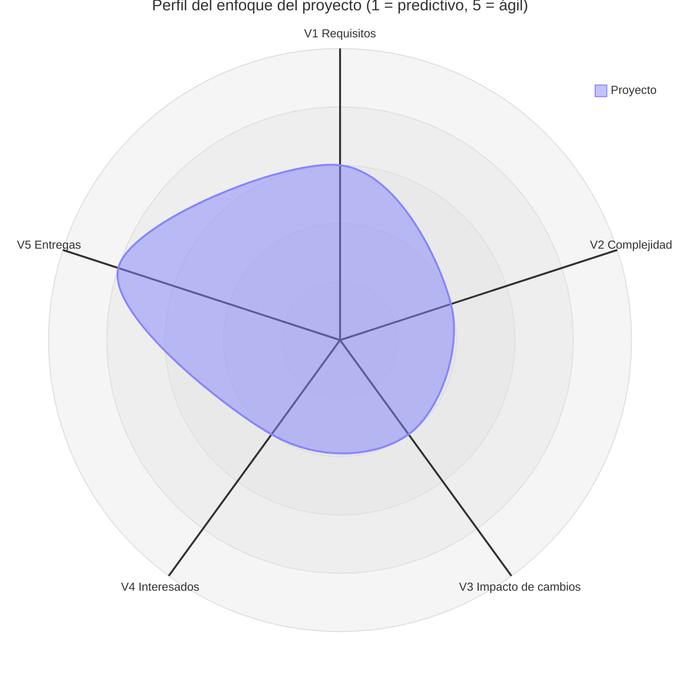

[← Volver al README Principal](../../README.md)

# 01. Selección del enfoque del proyecto

| Campo | Detalle |
|---|---|
| **Proyecto** | Sistema web para la gestión y planificación pedagógica en educación primaria – I.E. Virgen del Carmen, Huayucachi |
| **Integrantes** | Cuicapuza Remigio Nayely Nilda · Martinez Llanos Marco Jhair · Vera Zea Jhoanna Hade |
| **Asesor** | Ing. Elvis Wilfredo Carmen Delgadillo |
| **Fecha** | 14/10/2026 |
| **Versión** | 1.0.0 |

---

## 1. Propósito del documento

Este documento determina y justifica el enfoque de gestión con el que se desarrollará el sistema web. Las opciones son predictivo, ágil o híbrido. La elección se basa en una matriz de ponderación de cinco variables y en los criterios de selección del enfoque de desarrollo de PMBOK 7.ª edición [PMI-2021].

## 2. Contexto que condiciona el enfoque

- **Alcance anclado a una investigación.** El sistema es la variable independiente de un proyecto de tesis con diseño preexperimental de preprueba y posprueba. Sus tres módulos corresponden a las tres dimensiones de la variable dependiente:
  - planificación de sesiones de aprendizaje;
  - registro y control de notas;
  - control de asistencia.
- **Indicadores ya definidos.** Los indicadores con que se medirá el sistema (tiempo y exactitud) ya están fijados en la matriz de operacionalización de la tesis.
- **Hito condicionado por la medición.** Antes de la posprueba, el sistema debe estar disponible y operativo, y su presencia se verificará con una lista de cotejo funcional.
- **Usuarios con poca disponibilidad.** Los usuarios son docentes de primaria y la dirección de la I.E. Por ahora, el equipo no tiene acceso frecuente a ellos para validar avances.
- **Equipo pequeño.** Son tres integrantes, en un contexto académico y sin financiamiento externo.

## 3. Matriz de ponderación de variables

**Escala.** Cada variable recibe un puntaje de 1 a 5 según cuánto empuja el proyecto hacia un enfoque ágil:
- **1** = predictivo puro;
- **3** = neutro;
- **5** = ágil puro.

**Pesos.** Las cinco variables pesan lo mismo, un 20 % cada una.

**Criterio de decisión según el promedio:**

| Promedio | Enfoque |
|---|---|
| ≤ 2,0 | Predictivo |
| 2,1 a 3,9 | Híbrido |
| ≥ 4,0 | Ágil |

| ID | Variable | Situación del proyecto | Puntaje (1–5) | Tendencia |
|---|---|---|:---:|---|
| V1 | Claridad y estabilidad de requisitos | El alcance general es claro y estable: lo fija la tesis con tres módulos e indicadores de tiempo y exactitud. El detalle aún no se conoce, porque falta conocer el formato de sesión que usa la I.E., cómo se registran las notas por competencia y el flujo real del control de asistencia. | **3** | Neutra |
| V2 | Complejidad técnica e innovación | Es un sistema web de registro y consulta con control de acceso por roles (docente y directivo). No integra otros sistemas, no usa tecnologías emergentes y no reemplaza al SIAGIE. La principal exigencia técnica es que funcione desde el celular del docente. | **2** | Predictiva |
| V3 | Severidad del impacto ante cambios | Un cambio en los módulos o en los indicadores obligaría a modificar la matriz, las hipótesis y los instrumentos de la tesis, así que su costo es alto. Los cambios dentro de un módulo, como pantallas, campos u orden de pasos, tienen bajo costo. | **2** | Predictiva |
| V4 | Disponibilidad de los interesados | Los docentes y la dirección de la I.E. todavía no están disponibles para validar avances con frecuencia. | **2** | Predictiva |
| V5 | Frecuencia de entregas de valor | Cada módulo puede entregarse y mostrarse como un incremento independiente. El hito clave es llegar a un sprint funcional que permita las pruebas con docentes y en campo. | **4** | Ágil |
| | **Promedio ponderado** | | **2,6** | **Híbrido** |

## 4. Diagrama de radar del enfoque

**Lectura del perfil.** El polígono se concentra en la zona predictiva en tres ejes: complejidad, impacto de cambios e interesados. Queda en el punto medio en requisitos y solo se abre hacia lo ágil en la frecuencia de entregas. El resultado no es un perfil predictivo puro ni ágil puro, y por eso respalda un enfoque híbrido.

## 5. Decisión y justificación del enfoque

### 5.1. Enfoque seleccionado

> **Enfoque HÍBRIDO:** marco predictivo para el alcance, la línea base de requisitos y los hitos ligados a la investigación; ejecución adaptativa por iteraciones (sprints) para construir cada módulo.

### 5.2. Justificación según PMBOK 7.ª edición

PMBOK 7 reconoce tres enfoques de desarrollo: predictivo, adaptativo e híbrido. Indica que el enfoque se elige según las características del entregable, del proyecto y de la organización, y que se adapta al contexto de cada proyecto [PMI-2021, p. PENDIENTE]. Aplicado a este proyecto:

| Criterio de selección | Cómo se presenta en el proyecto | Enfoque que favorece |
|---|---|---|
| Certeza de los requisitos y estabilidad del alcance | El alcance general es estable y está fijado por la tesis. El detalle de cada módulo se conocerá al levantar información en la I.E. (V1). | Predictivo en el alcance, adaptativo en el detalle |
| Grado de innovación | Hay poca innovación: es un sistema de registro con roles y tecnología conocida (V2). | Predictivo |
| Facilidad de cambio | Cambiar el alcance es costoso porque afecta a la investigación. Cambiar el detalle de un módulo es barato (V3). | Predictivo en el alcance, adaptativo en el detalle |
| Opciones de entrega | El producto puede entregarse por módulos independientes (V5). | Adaptativo |
| Interesados | Su disponibilidad es baja por ahora. Por eso conviene fijar una línea base de requisitos antes de construir y validar con ellos en momentos concretos (V4). | Predictivo |
| Restricciones de cronograma | El sistema debe estar operativo antes de la posprueba. | Predictivo para los hitos |
| Tamaño del equipo | Son tres integrantes que trabajan juntos y se coordinan de forma directa. | Adaptativo para la ejecución |

[PMI-2021, p. PENDIENTE] para los criterios de selección del enfoque.

El material de clase del asesor apunta en la misma dirección [MATERIAL-ASESOR, secc. 4]:
- cascada sirve para proyectos pequeños con requisitos estables;
- el desarrollo incremental sirve para entregas parciales con valor temprano;
- el ágil sirve para equipos colaborativos que trabajan en iteraciones cortas.

Este proyecto tiene rasgos de los tres. Por eso se combinan en lugar de elegir uno solo.

### 5.3. Cómo se aplica el enfoque

| Componente | Qué se gestiona así | Artefactos |
|---|---|---|
| **Predictivo** | Alcance de cuatro bloques: los tres módulos y usuarios y acceso | `01 Inicio/`: acta, visión, supuestos y restricciones, interesados |
| **Predictivo** | Línea base de requisitos aprobada antes de construir | `01 Inicio/`: requisitos funcionales y no funcionales, usuarios, reglas de negocio |
| **Predictivo** | Hitos ligados a la investigación: sistema operativo y lista de cotejo funcional antes de la posprueba | Acta de constitución |
| **Adaptativo** | Construcción por sprints de 2 semanas con un backlog priorizado | `02 Planificación/`: Transformando a ágil y tablero en GitHub Projects |
| **Adaptativo** | Incrementos por módulo, mostrados a los interesados cuando haya acceso a la I.E. | `03 Implementación/`: documentos de cada sprint |

### 5.4. Control de cambios

- **Cambios dentro de un módulo** (campos, pantallas, orden de pasos): entran al backlog y se priorizan en el siguiente sprint.
- **Cambios que afectan dimensiones, indicadores o el alcance general:** no se aprueban en el proyecto de software. Se elevan al equipo de tesis, porque modifican la investigación.
- **Cambios en un documento ya aprobado:** se sube su versión (V_1_1_0 para cambios menores, V_2_0_0 para cambios estructurales) y se registran en su historial.

### 5.5. Hito principal

Llegar a un **sprint funcional** que permita las pruebas con docentes y en campo. No hay una fecha fija de entrega. Las fechas se estimarán en el Acta de constitución.

## 6. Supuestos de esta evaluación

| ID | Supuesto | Qué lo cambiaría |
|---|---|---|
| S1 | Las cinco variables pesan lo mismo. | Que el equipo decida ponderar más V1 y V3. |
| S2 | La disponibilidad de los interesados es baja (V4 = 2). | Conseguir acceso estable a la I.E.: V4 subiría a 3 y el promedio a 2,8, que sigue siendo híbrido. |
| S3 | El detalle de los requisitos depende de datos que aún no se tienen: formato de sesión de la I.E., registro por competencia, flujo de asistencia y conectividad y dispositivos de los docentes [DATO I.E. PENDIENTE]. | Levantar esos datos en la I.E. |

## Referencias

- **[PMI-2021]** PROJECT MANAGEMENT INSTITUTE. *La guía de los fundamentos para la dirección de proyectos (Guía del PMBOK) y El estándar para la dirección de proyectos*. 7.ª ed. Newtown Square, PA: Project Management Institute, 2021. [PENDIENTE: confirmar la edición o el idioma consultado y las páginas citadas].
- **[MATERIAL-ASESOR]** *¿Cómo elaborar software? Pasos y procedimiento completo. Guía práctica para Ingeniería de Sistemas*. Material de clase del curso Investigación II, proporcionado por el Ing. Elvis Wilfredo Carmen Delgadillo. Universidad Continental. [PENDIENTE: autor y año].

## Historial de cambios

| Versión | Fecha | Autor | Descripción |
|---|---|---|---|
| 1.0.0 | 14/10/2026 | Equipo del proyecto | Versión inicial: matriz de ponderación, radar y decisión de enfoque híbrido. |

[← Volver al README Principal](../../README.md)
