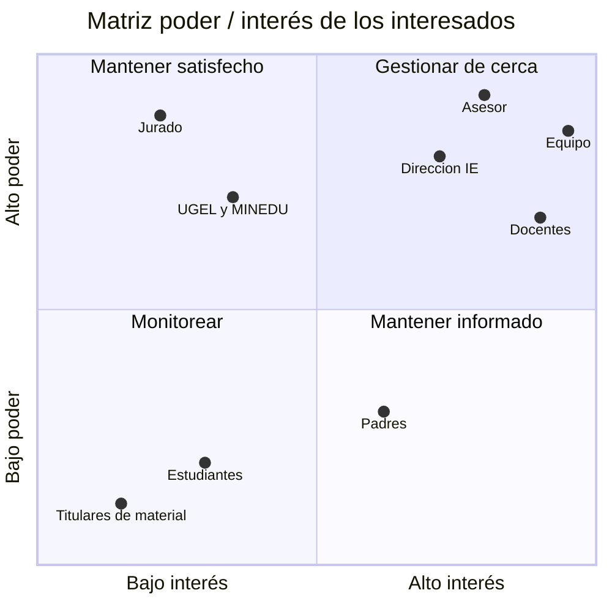

[← Volver al README Principal](../../README.md)

# 05. Registro de interesados

| Campo | Detalle |
|---|---|
| **Proyecto** | Sistema web para la gestión y planificación pedagógica en educación primaria – I.E. Virgen del Carmen, Huayucachi |
| **Producto** | CarpetaDocente (nombre temporal) |
| **Integrantes** | Cuicapuza Remigio Nayely Nilda · Martinez Llanos Marco Jhair · Vera Zea Jhoanna Hade |
| **Asesor** | Ing. Elvis Wilfredo Carmen Delgadillo |
| **Fecha** | 14/10/2026 |
| **Versión** | 1.0.0 |

---

## 1. Matriz de identificación de interesados

| ID | Nombre / Rol | Organización / Área | Información de contacto | Categoría |
|---|---|---|---|---|
| INT-01 | Equipo del proyecto: Martinez Llanos Marco Jhair (Director de Proyecto), Cuicapuza Remigio Nayely Nilda y Vera Zea Jhoanna Hade | Universidad Continental – Ingeniería de Sistemas e Informática | Por definir | Interno |
| INT-02 | Asesor: Ing. Elvis Wilfredo Carmen Delgadillo | Universidad Continental – curso Investigación II | Por definir | Interno |
| INT-03 | Dirección de la I.E., o quien maneje el SIAGIE en la institución [DATO I.E. PENDIENTE] | I.E. Virgen del Carmen – Huayucachi | Por definir | Externo |
| INT-04 | Docentes de primaria con sección a cargo (usuarios principales) | I.E. Virgen del Carmen – Huayucachi | Por definir | Externo |
| INT-05 | Jurado de la tesis | Universidad Continental | No aplica (se comunica en la sustentación) | Externo |
| INT-06 | UGEL Huancayo y MINEDU, como entidades que norman la evaluación y el SIAGIE | Sector Educación | No aplica (se consultan sus normas y formatos) | Externo |
| INT-07 | Padres de familia o apoderados | Comunidad educativa de la I.E. | A través de la dirección | Externo |
| INT-08 | Estudiantes de primaria, como titulares de los datos personales que registra el sistema | I.E. Virgen del Carmen – Huayucachi | No aplica (menores de edad; no se contacta directamente) | Externo |
| INT-09 | Titulares del material de sesiones de terceros | Externos al proyecto | Por definir, al verificar cada fuente (ver SUP-08 del documento 04) | Externo |

## 2. Matriz poder / interés

| ID | Interesado | Poder | Interés | Cuadrante | Justificación |
|---|---|---|---|---|---|
| INT-01 | Equipo del proyecto | Alto | Alto | Gestionar de cerca | Decide el alcance, construye el sistema y depende de él para la tesis. |
| INT-02 | Asesor | Alto | Alto | Gestionar de cerca | Evalúa el avance de la tesis, y el sistema es su variable independiente. |
| INT-03 | Dirección de la I.E. | Alto | Alto | Gestionar de cerca | Autoriza el acceso, el piloto y el uso de datos reales, y consulta los consolidados. |
| INT-04 | Docentes de primaria | Alto | Alto | Gestionar de cerca | Individualmente tienen poco poder, pero sin su participación no hay piloto, ni repositorio de sesiones, ni medición de la tesis. |
| INT-05 | Jurado de la tesis | Alto | Bajo | Mantener satisfecho | Aprueba la tesis, pero no sigue el desarrollo del sistema. |
| INT-06 | UGEL Huancayo / MINEDU | Alto | Bajo | Mantener satisfecho | Sus normas y formatos condicionan el registro de notas y las exportaciones. No participan en el proyecto; se incluyen como aproximación. |
| INT-07 | Padres o apoderados | Bajo | Medio | Mantener informado | Les interesa cómo se usan los datos y las notas de sus hijos, pero no deciden sobre el sistema. |
| INT-08 | Estudiantes | Bajo | Bajo | Monitorear | No usan el sistema; sus datos se protegen según la Ley N.° 29733. |
| INT-09 | Titulares del material de terceros | Bajo | Bajo | Monitorear | Solo intervienen si su material se incluye en el repositorio, y únicamente con uso permitido. |

## 3. Estrategia de gestión y comunicación

| Grupo | Estrategia | Frecuencia | Formato / canal | Información que se entrega | Responsable |
|---|---|---|---|---|---|
| Equipo (INT-01) | Gestionar de cerca | Diaria durante los sprints; revisión al cierre de cada sprint | Tablero de GitHub Projects y chat del equipo | Avance, impedimentos, decisiones y cambios de versión de los documentos | Director de Proyecto |
| Asesor (INT-02) | Gestionar de cerca | Semanal, en la clase del curso Investigación II | Consultas puntuales en clase; documentos del repositorio | Avance de la documentación y del sistema, y dudas de coherencia con la tesis | Equipo |
| Dirección (INT-03) | Gestionar de cerca | En la presentación del incremento funcional (H6), al inicio y durante el piloto, y al cierre | Reunión presencial con demo; coordinación por WhatsApp o por el canal que indique la dirección | Qué hace el sistema, permisos y protección de datos, solicitud de la carta de aceptación actualizada, resultados del piloto | Director de Proyecto |
| Docentes (INT-04) | Gestionar de cerca | Capacitación al inicio del piloto; seguimiento semanal durante el piloto | Capacitación presencial y grupo de WhatsApp | Uso del sistema, cambios y recojo de observaciones | Equipo |
| Jurado (INT-05) | Mantener satisfecho | En la presentación y sustentación de la tesis | Documento de tesis y demostración del sistema | Resultados de la investigación y evidencia del sistema operativo | Equipo |
| UGEL / MINEDU (INT-06) | Mantener satisfecho | Sin contacto directo | Consulta de normas y formatos vigentes | — (el equipo verifica que el sistema respete sus normas y formatos) | Equipo |
| Padres (INT-07) | Mantener informado | Una vez, al inicio del piloto | Comunicado a través de la dirección | Qué datos se registran, con qué fin y cómo se protegen | Dirección, con apoyo del equipo |
| Estudiantes (INT-08) | Monitorear | Durante todo el proyecto | No se comunica directamente | — (se vigila el cumplimiento de la protección de datos) | Director de Proyecto |
| Titulares de material (INT-09) | Monitorear | Solo al verificar una fuente | Contacto puntual por el medio que indique el titular | Solicitud de autorización de uso, si corresponde | Director de Proyecto o integrante delegado |

## 4. Datos pendientes

- Información de contacto de todos los interesados (por definir).
- Si la dirección sigue a cargo de la misma persona y quién maneja el SIAGIE en la I.E. [DATO I.E. PENDIENTE].
- Si existe un subdirector o coordinador de primaria que deba figurar como interesado [DATO I.E. PENDIENTE].

## Historial de cambios

| Versión | Fecha | Autor | Descripción |
|---|---|---|---|
| 1.0.0 | 14/10/2026 | Equipo del proyecto | Versión inicial: identificación de 9 interesados, matriz poder/interés y estrategia de comunicación. |

[← Volver al README Principal](../../README.md)
