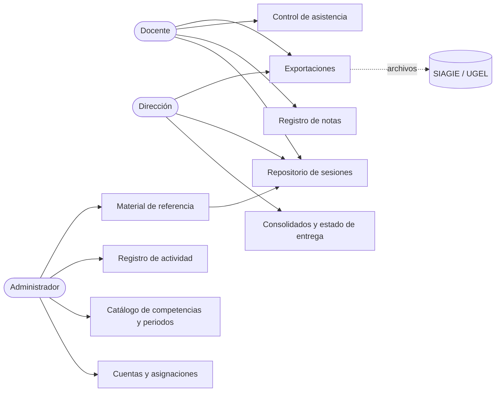

[← Volver al README Principal](../../README.md)

# 08. Usuarios

| Campo | Detalle |
|---|---|
| **Proyecto** | Sistema web para la gestión y planificación pedagógica en educación primaria – I.E. Virgen del Carmen, Huayucachi |
| **Producto** | CarpetaDocente (nombre temporal) |
| **Integrantes** | Cuicapuza Remigio Nayely Nilda · Martinez Llanos Marco Jhair · Vera Zea Jhoanna Hade |
| **Asesor** | Ing. Elvis Wilfredo Carmen Delgadillo |
| **Fecha** | 14/10/2026 |
| **Versión** | 1.1.0 |

---

## 1. Matriz de roles y actores

### 1.1. Actores directos (usan el sistema)

| Rol | Quién lo ocupa | Objetivo en el sistema | Frecuencia de uso esperada | Dispositivo principal |
|---|---|---|---|---|
| **Docente** | Docente de primaria con una sección a cargo | Reducir el tiempo que dedica a planificar sesiones, registrar notas y controlar la asistencia | Diaria (asistencia) y por periodo (notas); según necesidad (sesiones) | Celular; computadora para descargar y adaptar sesiones |
| **Dirección** | Director(a) de la I.E., o quien maneje el SIAGIE en la institución [DATO I.E. PENDIENTE] | Monitorear la práctica pedagógica y obtener los consolidados sin pedir documentos físicos | Semanal y al cierre de cada periodo | Computadora o celular |
| **Administrador** | Equipo del proyecto; más adelante, el encargado de informática de la I.E. [DATO I.E. PENDIENTE] | Mantener las cuentas, las asignaciones y los catálogos para que los demás roles trabajen | Al inicio del año escolar y a pedido | Computadora |

El nivel de manejo digital de los docentes y la dirección se validará en el levantamiento de información en la I.E. (documento 06, sección 1.2).

### 1.2. Actores indirectos (no usan el sistema)

| Actor | Relación con el sistema |
|---|---|
| Estudiantes de primaria | Son los titulares de los datos que se registran: nombres, notas y asistencia. Sus datos se protegen según la Ley N.° 29733. |
| Padres o apoderados | No tienen acceso. La dirección los informa sobre el uso de los datos (documento 05). |
| SIAGIE y UGEL | Reciben los archivos que exportan el docente o la dirección. El sistema no se conecta con ellos. |

## 2. Historias de uso resumidas

| Rol | Historia resumida | RF involucrados |
|---|---|---|
| Docente | Como docente, quiero importar una sola vez la lista de mi sección, para no volver a escribir los nombres de mis estudiantes. | RF-006 |
| Docente | Como docente, quiero buscar y descargar sesiones por grado y área, para adaptarlas en mi procesador de textos en lugar de empezar desde cero o comprarlas. | RF-011, RF-012 |
| Docente | Como docente, quiero subir mis sesiones al repositorio aceptando que se publiquen, para que otros docentes puedan reutilizarlas y yo tenga las mías en un solo lugar. | RF-010, RF-013, RF-014, RF-016 |
| Docente | Como docente, quiero registrar la asistencia de mi sección desde el celular, para hacerlo en el aula sin hojas de papel. | RF-030, RF-031, RF-032, RF-033 |
| Docente | Como docente, quiero registrar el nivel de logro de cada estudiante por competencia, para tener el registro auxiliar sin transcribir en hojas de cálculo. | RF-020, RF-021, RF-022, RF-023, RF-029, RF-035 |
| Docente | Como docente, quiero exportar mis notas y mi asistencia, para entregarlas a la dirección o cargarlas en el SIAGIE. | RF-024, RF-025, RF-026, RF-034 |
| Dirección | Como dirección, quiero consultar las notas, la asistencia y las sesiones de cada sección, para monitorear la práctica pedagógica sin pedir documentos físicos. | RF-040 |
| Dirección | Como dirección, quiero ver qué docentes entregaron sus notas y descargar los consolidados, para preparar la carga en el SIAGIE. | RF-041, RF-042 |
| Dirección | Como dirección, quiero subir las sesiones que me entregan los docentes, para que formen parte del repositorio. | RF-017 |
| Administrador | Como administrador, quiero crear las cuentas y asignar las secciones, para que cada docente vea solo lo que le corresponde. | RF-003, RF-005, RF-007 |
| Administrador | Como administrador, quiero cargar las competencias, los periodos y el material de referencia, para que el sistema esté listo al inicio del año escolar. | RF-018, RF-027, RF-028 |
| Administrador | Como administrador, quiero revisar el registro de actividad, para atender incidencias y calcular los indicadores de adopción. | RF-008 |
| Administrador | Como administrador, quiero cerrar el año escolar cuando la dirección ya descargó los consolidados, para no conservar datos de estudiantes más tiempo del necesario. | RF-009 |

## 3. Matriz de control de acceso (RBAC)

**Notación:** C = crear · R = leer (incluye descargar) · U = actualizar · D = eliminar físicamente.

| Módulo / capacidad | Rol: Docente | Rol: Dirección | Rol: Administrador |
|---|---|---|---|
| Cuentas de usuario | Sin acceso | Sin acceso | CRU (desactiva; no elimina) |
| Contraseña propia | U | U | U |
| Asignación de grado y sección | R (la propia) | R | CRU |
| Lista de estudiantes | CRU (su sección) | R | Sin acceso |
| Sesiones propias | CRUD | R | Sin acceso |
| Sesiones de otros docentes (repositorio) | R | R | Sin acceso |
| Aceptación de los términos de publicación | C (al subir cada sesión propia) | C (registra la del docente al subir una sesión entregada) | Sin acceso |
| Subir sesiones entregadas por docentes | Sin acceso | C | Sin acceso |
| Material de referencia | R | R | CRU |
| Competencias desarrolladas en el periodo | CU (su sección) | R | Sin acceso |
| Exoneraciones de estudiantes (Educación Religiosa, Educación Física) | CU (su sección) | R | Sin acceso |
| Notas | CRU (su sección, hasta marcarlas como entregadas) | R | Sin acceso |
| Habilitar la corrección de notas entregadas | Sin acceso | U | Sin acceso |
| Asistencia (Asistió, Tarde, Faltó, Justificado) | CRU (su sección) | R | Sin acceso |
| Catálogo de áreas y competencias | R | R | CRU (desactiva; no elimina) |
| Periodos del año escolar | R | R | CRU |
| Consolidados y estado de entrega | Sin acceso | R | Sin acceso |
| Exportación de notas y asistencia | R (su sección) | R (todas las secciones) | Sin acceso |
| Registro de actividad (auditoría) | Sin acceso | Sin acceso | R (solo lectura) |
| Exportación del registro de actividad | Sin acceso | Sin acceso | R |
| Cierre del año escolar | Sin acceso | U (confirma que descargó los consolidados) | D (ejecuta la eliminación, sin ver los datos) |
| Depuración / eliminación física | D (solo sus sesiones) | Sin acceso | Solo mediante el cierre del año escolar |

### 3.1. Reglas de acceso

- **Mínimo privilegio para el administrador.** El administrador no ve notas, asistencia, listas de estudiantes ni sesiones de los docentes. Administra cuentas y catálogos, y para dar soporte trabaja con datos ficticios. Así se cumple el principio de proporcionalidad de la Ley N.° 29733 (RES-02).
- **Publicación con consentimiento.** No hay sesiones privadas. Al subir una sesión, el docente acepta los términos de publicación y la sesión queda visible para todos los docentes y la dirección. Si no los acepta, la sesión no se sube. Para retirarla, el docente la elimina (RF-016).
- **Registro de las operaciones.** Cada operación de creación, modificación o eliminación queda en el registro de actividad (RF-008, RNF-016), incluidas las que hace la dirección.
- **Sin eliminación física durante el año escolar.** Las notas, la asistencia, las cuentas y las competencias se desactivan o se corrigen, pero no se eliminan. Hay dos excepciones: un docente puede eliminar sus propias sesiones (RF-016), y al cierre del año escolar se eliminan las listas de estudiantes, las notas y la asistencia, una vez que la dirección confirma que descargó los consolidados (RF-009).

## 4. Decisiones provisionales

| Decisión | Estado | Cómo se confirma |
|---|---|---|
| La dirección solo lee notas y asistencia, y habilita las correcciones. No registra en nombre de un docente. | Provisional, para el Sprint 1 | Consultar con la integrante del equipo con experiencia docente y en el levantamiento de información en la I.E. Si en la I.E. la dirección registra notas, se agrega un permiso de registro en nombre de un docente (nueva versión de los documentos 06 y 08). |
| El rol Administrador lo ocupa el equipo del proyecto. | Vigente | Se revisa si la I.E. designa un encargado de informática [DATO I.E. PENDIENTE]. |

## Historial de cambios

| Versión | Fecha | Autor | Descripción |
|---|---|---|---|
| 1.0.0 | 14/10/2026 | Equipo del proyecto | Versión inicial: roles y actores, historias de uso resumidas y matriz de control de acceso. |
| 1.1.0 | 14/10/2026 | Equipo del proyecto | Se agregan las competencias desarrolladas por periodo (RF-029), los cuatro estados de asistencia, la exoneración de estudiantes (RF-035) y el cierre del año escolar (RF-009). |

[← Volver al README Principal](../../README.md)
