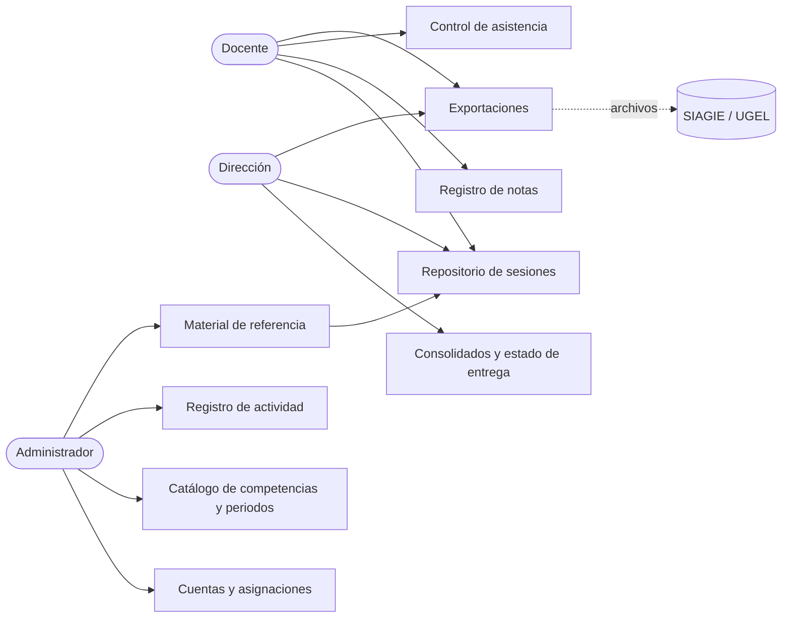

[← Volver al README Principal](../../README.md)

# 08. Usuarios

| Campo | Detalle |
|---|---|
| **Proyecto** | Sistema web para la gestión y planificación pedagógica en educación primaria – I.E. Virgen del Carmen, Huayucachi |
| **Producto** | CarpetaDocente (nombre temporal) |
| **Integrantes** | Cuicapuza Remigio Nayely Nilda · Martinez Llanos Marco Jhair · Vera Zea Jhoanna Hade |
| **Asesor** | Ing. Elvis Wilfredo Carmen Delgadillo |
| **Fecha** | 24/11/2026 |
| **Versión** | 1.2.0 |

---

## 1. Matriz de roles y actores

### 1.1. Actores directos (usan el sistema)

| Rol | Quién lo ocupa | Objetivo en el sistema | Frecuencia de uso esperada | Dispositivo principal |
|---|---|---|---|---|
| **Docente** | Docente de primaria con una sección a cargo (tutora de la sección) | Reducir el tiempo que dedica a planificar sesiones, registrar notas y controlar la asistencia | Diaria (asistencia) y por periodo (notas); según necesidad (sesiones) | Celular; computadora para descargar y adaptar sesiones |
| **Dirección** | Director(a) de la I.E., o quien maneje el SIAGIE en la institución [DATO I.E. PENDIENTE] | Monitorear la práctica pedagógica y obtener los consolidados sin pedir documentos físicos | Semanal y al cierre de cada periodo | Computadora o celular |
| **Docente de curso** | Docente de un área que dicta en varias secciones, por ejemplo Educación Física o Inglés. Cuántos son en la I.E., qué áreas dictan y si llevan asistencia: [DATO I.E. PENDIENTE] | Enviar sus sesiones del área a la dirección y registrar las notas de su área (historia US-036, pendiente). Hoy entra como Docente: envía sesiones, y el Administrador marca su área como «a cargo del docente de curso» para que la tutora no la califique | Por periodo (notas); según necesidad (sesiones) | Celular o computadora |
| **Administrador** | Equipo del proyecto; más adelante, el encargado de informática de la I.E. [DATO I.E. PENDIENTE] | Mantener las cuentas, las asignaciones y los catálogos para que los demás roles trabajen | Al inicio del año escolar y a pedido | Computadora |

El nivel de manejo digital de los docentes y la dirección se validará en el levantamiento de información en la I.E. (documento 06, sección 1.2).

### 1.2. Actores indirectos (no usan el sistema)

| Actor | Relación con el sistema |
|---|---|
| Estudiantes de primaria | Son los titulares de los datos que se registran: nombres, notas y asistencia. Sus datos se protegen según la Ley N.° 29733. |
| Padres o apoderados | No tienen acceso. La dirección los informa sobre el uso de los datos. |
| SIAGIE | Solo la dirección entra al SIAGIE. El sistema completa la plantilla de notas que la dirección descarga del SIAGIE y la devuelve llena para que ella la cargue; no se conecta con el SIAGIE. |

## 2. Historias de uso resumidas

| Rol | Historia resumida | RF involucrados |
|---|---|---|
| Docente | Como docente, quiero importar una sola vez la lista de mi sección, para no volver a escribir los nombres de mis estudiantes. | RF-006 |
| Docente | Como docente, quiero buscar y descargar sesiones por grado y área, para adaptarlas en mi procesador de textos en lugar de empezar desde cero o comprarlas. | RF-011, RF-012 |
| Docente | Como docente, quiero enviar mis sesiones a la dirección y, si quiero, compartirlas en el repositorio aceptando los términos de publicación, para entregarlas sin papel, que otros docentes puedan reutilizarlas y tener las mías en un solo lugar. | RF-010, RF-013, RF-014, RF-016 |
| Docente | Como docente, quiero registrar la asistencia de mi sección desde el celular, para hacerlo en el aula sin hojas de papel. | RF-030, RF-031, RF-032, RF-033 |
| Docente | Como docente, quiero registrar el nivel de logro de cada estudiante por competencia, para tener el registro auxiliar sin transcribir en hojas de cálculo. | RF-020, RF-021, RF-022, RF-023, RF-029, RF-035 |
| Docente | Como docente, quiero marcar mis notas como entregadas y exportar mi asistencia, para entregarlas a la dirección. | RF-026, RF-034 |
| Dirección | Como dirección, quiero consultar las notas, la asistencia y las sesiones enviadas de cada sección, para monitorear la práctica pedagógica sin pedir documentos físicos. | RF-040 |
| Dirección | Como dirección, quiero subir la plantilla de notas del SIAGIE y recibirla llena, para cargarla en el SIAGIE sin transcribir. | RF-024, RF-025 |
| Dirección | Como dirección, quiero ver qué docentes entregaron sus notas y descargar los consolidados, para preparar la carga en el SIAGIE. | RF-041, RF-042 |
| Administrador | Como administrador, quiero crear las cuentas y asignar las secciones, para que cada docente vea solo lo que le corresponde. | RF-003, RF-005, RF-007 |
| Administrador | Como administrador, quiero cargar las competencias, los periodos y el material de referencia, para que el sistema esté listo al inicio del año escolar. | RF-018, RF-027, RF-028 |
| Administrador | Como administrador, quiero revisar el registro de actividad, para atender incidencias y calcular los indicadores de adopción. | RF-008 |
| Administrador | Como administrador, quiero cerrar el año escolar cuando la dirección ya descargó los consolidados, para no conservar datos de estudiantes más tiempo del necesario. | RF-009 |

## 3. Matriz de control de acceso (RBAC)

**Notación:** C = crear · R = leer (incluye descargar) · U = actualizar · D = eliminar físicamente.

| Módulo / capacidad | Rol: Docente | Rol: Dirección | Rol: Administrador |
|---|---|---|---|
| Cuentas de usuario | Sin acceso | Sin acceso | CRU (desactiva; no elimina) |
| Contraseña propia | U | U | U |
| Asignación de grado y sección | R (la propia) | R | CRU |
| Lista de estudiantes | CRU (su sección) | R | Sin acceso |
| Sesiones propias | CRUD (enviar, compartir, dejar de compartir y eliminar; eliminar la quita para todos) | R (todas las enviadas por docentes de su institución, compartidas o no) | Sin acceso |
| Sesiones de otros docentes (repositorio) | R (solo las compartidas) | R (las enviadas) | Sin acceso |
| Aceptación de los términos de publicación | C (al compartir cada sesión propia) | Sin acceso | Sin acceso |
| Material de referencia | R | Sin acceso | CRUD (elimina solo las sesiones de referencia) |
| Competencias desarrolladas en el periodo | CUD (su sección; desmarcar borra la marca, salvo que la competencia ya tenga notas en ese periodo; no las de las áreas a cargo del docente de curso) | R (consolidados) | Sin acceso |
| Exoneraciones de estudiantes (Educación Religiosa, Educación Física) | CU (su sección) | R | Sin acceso |
| Notas | CRU (su sección, hasta marcarlas como entregadas) | R | Sin acceso |
| Habilitar la corrección de notas entregadas | Sin acceso | U | Sin acceso |
| Asistencia (Asistió, Tarde, Faltó, Justificado) | CRU (su sección) | R | Sin acceso |
| Catálogo de áreas y competencias | R | R | CRU (desactiva; no elimina; marca las áreas que se trabajan y las que están a cargo del docente de curso) |
| Periodos del año escolar | R | R | CRU |
| Consolidados y estado de entrega | Sin acceso | R | Sin acceso |
| Plantilla de notas del SIAGIE (completar) | Sin acceso | C (todas las secciones de su institución) | Sin acceso |
| Exportación de asistencia | R (su sección) | R (todas las secciones) | Sin acceso |
| Registro de actividad (auditoría) | Sin acceso | Sin acceso | R (solo lectura) |
| Exportación del registro de actividad | Sin acceso | Sin acceso | R |
| Cierre del año escolar | Sin acceso | U (confirma que descargó los consolidados) | D (ejecuta la eliminación, sin ver los datos) |
| Depuración / eliminación física | D (solo sus sesiones) | Sin acceso | Solo mediante el cierre del año escolar |

### 3.1. Reglas de acceso

- **Mínimo privilegio para el administrador.** El administrador no ve notas, asistencia, listas de estudiantes ni sesiones de los docentes. Administra cuentas y catálogos, y para dar soporte trabaja con datos ficticios. Así se cumple el principio de proporcionalidad de la Ley N.° 29733 (RN-015 y RN-018 del documento 09).
- **Entrega a la dirección y publicación con consentimiento.** Toda sesión que envía un docente llega a la dirección. Compartirla en el repositorio es opcional: para hacerlo, el docente acepta los términos de publicación y la sesión queda visible para los demás docentes. Puede dejar de compartirla, y al eliminarla (RF-016) desaparece para todos.
- **Registro de las operaciones.** Cada operación de creación, modificación o eliminación queda en el registro de actividad (RF-008, RNF-016), incluidas las que hace la dirección. Los intentos sin permiso que se registran son los de una docente sobre una sección, un estudiante o una sesión ajenos; los demás roles que entran a una ruta que no es suya van a su inicio sin entrada en el registro.
- **Sin permiso.** Una docente que abre una sección ajena ve «No tienes permiso para ver esta sección» (403).
- **Sin eliminación física durante el año escolar.** Las notas, la asistencia, las cuentas y las competencias se desactivan o se corrigen, pero no se eliminan. Hay dos excepciones: un docente puede eliminar sus propias sesiones (RF-016), y al cierre del año escolar se eliminan las listas de estudiantes, las notas y la asistencia, una vez que la dirección confirma que descargó los consolidados (RF-009).

## 4. Decisiones provisionales

| Decisión | Estado | Cómo se confirma |
|---|---|---|
| La dirección solo lee notas y asistencia, y habilita las correcciones. No registra en nombre de un docente. | Provisional, para el Sprint 1 | Consultar con la integrante del equipo con experiencia docente y en el levantamiento de información en la I.E. Si en la I.E. la dirección registra notas, se agrega un permiso de registro en nombre de un docente (nueva versión de los documentos 06 y 08). |
| Solo la dirección entra al SIAGIE: completa la plantilla de notas del SIAGIE con el sistema (RF-024, RF-025) y la carga ella. Los docentes de curso le entregan sus notas y sesiones. | Vigente desde US-024/025 (18/11/2026) | Falta confirmar si la dirección carga las notas con «Periodo por Excel» o las digita en la web del SIAGIE, y los nombres de las secciones en el SIAGIE [DATO I.E. PENDIENTE]. |
| El rol Administrador lo ocupa el equipo del proyecto. | Vigente | Se revisa si la I.E. designa un encargado de informática [DATO I.E. PENDIENTE]. |

## Historial de cambios

| Versión | Fecha | Autor | Descripción |
|---|---|---|---|
| 1.0.0 | 14/10/2026 | Equipo del proyecto | Versión inicial: roles y actores, historias de uso resumidas y matriz de control de acceso. |
| 1.1.0 | 14/10/2026 | Equipo del proyecto | Se agregan las competencias desarrolladas por periodo (RF-029), los cuatro estados de asistencia, la exoneración de estudiantes (RF-035) y el cierre del año escolar (RF-009). |
| 1.2.0 | 24/11/2026 | Equipo del proyecto | Pasada de docs: nuevo actor docente de curso; la dirección completa la plantilla del SIAGIE y recibe todas las sesiones enviadas; matriz de acceso con compartir, dejar de compartir y eliminar para todos, competencias con CUD y sin la subida de sesiones entregadas; reglas de acceso con el 403 de sección ajena; nueva decisión sobre el SIAGIE. |

[← Volver al README Principal](../../README.md)
