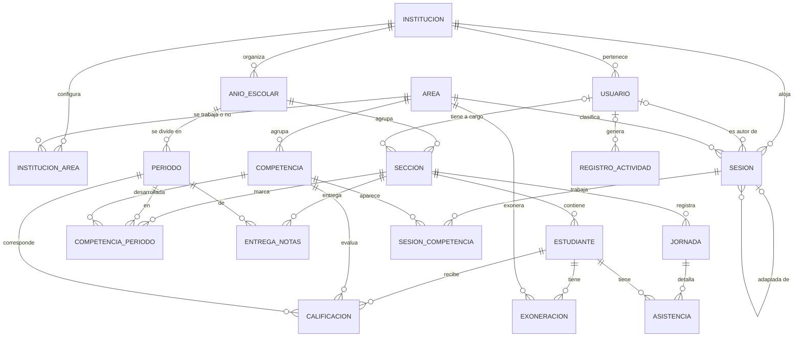

[← Volver al README Principal](../../README.md)

# 11. Base de datos

| Campo | Detalle |
|---|---|
| **Proyecto** | Sistema web para la gestión y planificación pedagógica en educación primaria – I.E. Virgen del Carmen, Huayucachi |
| **Producto** | CarpetaDocente (nombre temporal) |
| **Integrantes** | Cuicapuza Remigio Nayely Nilda · Martinez Llanos Marco Jhair · Vera Zea Jhoanna Hade |
| **Asesor** | Ing. Elvis Wilfredo Carmen Delgadillo |
| **Fecha** | 17/10/2026 |
| **Versión** | 1.2.0 |

---

## 1. Criterios de diseño

| Criterio | Decisión |
|---|---|
| Motor | PostgreSQL (documento 10) |
| Creación del esquema | Con las **migraciones de Django**. El DDL de la sección 4 es la especificación que los modelos deben reproducir |
| Identificadores | Enteros autoincrementales en todas las tablas. Las sesiones usan **UUID**, que también da nombre a su archivo en el almacenamiento, para que los enlaces no se puedan adivinar |
| Varias instituciones | La entidad `institucion` existe desde el inicio (documento 10, sección 4) |
| Datos personales | Del estudiante solo se guardan apellidos y nombres, y un código opcional si lo exige el formato de la UGEL. No se guarda el DNI ni la dirección IP de los usuarios (RN-015) |
| Cierre del año escolar | Las secciones, los estudiantes, las notas y la asistencia dependen del año escolar y se eliminan en cascada en el cierre (RF-009, RN-017). Las sesiones del repositorio no dependen del año y se conservan |
| Secciones | Cada sección tiene **un solo grado**: la I.E. es polidocente completa, sin aulas multigrado. Un docente puede tener **más de una sección** |
| Archivos | El archivo de cada sesión se guarda en el almacenamiento de objetos. La base de datos guarda solo su clave, su nombre, su tipo y su tamaño |

## 2. Modelo conceptual



## 3. Modelo lógico

PK = clave primaria · FK = clave foránea · UQ = valor único.

### 3.1. Institución y calendario

**`institucion`**

| Atributo | Tipo | Restricción | Descripción |
|---|---|---|---|
| id | entero | PK | |
| nombre | texto (200) | obligatorio | Nombre de la I.E. |
| codigo_modular | texto (20) | UQ, opcional | Código modular de la I.E. [DATO I.E. PENDIENTE] |
| organizacion_periodos | texto (10) | BIMESTRE o TRIMESTRE, opcional | RN-006. La I.E. Virgen del Carmen organiza el año en bimestres (dato aportado por Nayely Cuicapuza, profesora de inglés y encargada del acercamiento con la I.E., el 17/10/2026) |
| creado_en | fecha y hora | obligatorio | |

**`anio_escolar`**

| Atributo | Tipo | Restricción | Descripción |
|---|---|---|---|
| id | entero | PK | |
| institucion_id | entero | FK → institucion | |
| anio | entero corto | UQ con institucion_id | Por ejemplo, 2027 |
| estado | texto (10) | ABIERTO o CERRADO | |
| consolidados_confirmados_en | fecha y hora | opcional | La dirección confirma que descargó los consolidados (RF-009) |
| confirmado_por_id | entero | FK → usuario, opcional | |
| conservar_hasta | fecha | opcional | Fecha pedida por la dirección para postergar el cierre (RF-009, ruta feliz) |
| cerrado_en | fecha y hora | opcional | |

**`periodo`**

| Atributo | Tipo | Restricción | Descripción |
|---|---|---|---|
| id | entero | PK | |
| anio_escolar_id | entero | FK → anio_escolar, en cascada | |
| numero | entero corto | 1 a 4; UQ con anio_escolar_id | |
| fecha_inicio, fecha_fin | fecha | fin posterior al inicio | Que no se crucen con otro periodo lo valida la aplicación (RF-028) |

### 3.2. Usuarios, secciones y estudiantes

**`usuario`** (modelo de usuario propio de Django)

| Atributo | Tipo | Restricción | Descripción |
|---|---|---|---|
| id | entero | PK | |
| username | texto (150) | UQ | Usuario para iniciar sesión |
| password | texto (128) | obligatorio | Solo el hash (RNF-012) |
| first_name, last_name | texto (150) | | Nombres y apellidos |
| email | texto (254) | opcional | |
| rol | texto (15) | DOCENTE, DIRECCION o ADMINISTRADOR | Documento 08 |
| institucion_id | entero | FK → institucion, opcional | El administrador puede no pertenecer a una I.E. |
| is_active | booleano | | Se desactiva, no se elimina (RN-023) |
| is_staff, is_superuser | booleano | | Acceso al panel de administración de Django: solo el Administrador |
| debe_cambiar_password | booleano | | Contraseña temporal (RF-007) |
| intentos_fallidos | entero corto | | RN-024 |
| bloqueado_hasta | fecha y hora | opcional | RN-024 |
| last_login, date_joined | fecha y hora | | Campos estándar de Django |

**`seccion`**

| Atributo | Tipo | Restricción | Descripción |
|---|---|---|---|
| id | entero | PK | |
| anio_escolar_id | entero | FK → anio_escolar, en cascada | |
| grado | entero corto | 1 a 6 | |
| nombre | texto (20) | UQ con anio_escolar_id y grado | Por ejemplo, "A" o "Única" |
| docente_id | entero | FK → usuario, opcional | Una sección tiene un docente; un docente puede tener varias secciones |

**`estudiante`**

| Atributo | Tipo | Restricción | Descripción |
|---|---|---|---|
| id | entero | PK | |
| seccion_id | entero | FK → seccion, en cascada | |
| apellidos, nombres | texto (120) | UQ (seccion_id, apellidos, nombres) | Evita duplicados al importar (RF-006) |
| codigo_estudiante | texto (20) | opcional | Solo si lo exige el formato de la UGEL (RN-015) |
| estado | texto (12) | ACTIVO, TRASLADADO o RETIRADO | TRASLADADO y RETIRADO conservan sus notas y asistencia (RN-023); no se cuentan como pendientes ni entran a jornadas nuevas. Regla por confirmar en el documento 09. |
| fecha_estado | fecha | opcional | Fecha del último cambio de estado |

### 3.3. Catálogo curricular

**`area`**

| Atributo | Tipo | Restricción | Descripción |
|---|---|---|---|
| id | entero | PK | |
| nombre | texto (80) | UQ | Anexo 03 (documento 09, sección 3) |
| es_transversal | booleano | | Competencias transversales (RN-008) |
| admite_exoneracion | booleano | | Verdadero solo para Educación Religiosa y Educación Física (RN-010) |
| orden | entero corto | | Orden en pantalla |

**`competencia`**

| Atributo | Tipo | Restricción | Descripción |
|---|---|---|---|
| id | entero | PK | |
| area_id | entero | FK → area | |
| nombre | texto (250) | UQ con area_id | |
| orden | entero corto | | |
| activa | booleano | | Se desactiva, no se elimina (RF-027) |

**`institucion_area`**

| Atributo | Tipo | Restricción | Descripción |
|---|---|---|---|
| id | entero | PK | |
| institucion_id | entero | FK → institucion; UQ con area_id | |
| area_id | entero | FK → area | |
| se_trabaja | booleano | | Falso para las áreas que la I.E. no imparte (RN-007) |

### 3.4. Dimensión 1: repositorio de sesiones

**`sesion`**

| Atributo | Tipo | Restricción | Descripción |
|---|---|---|---|
| id | UUID | PK | También da nombre al archivo en el almacenamiento |
| institucion_id | entero | FK → institucion | |
| autor_id | entero | FK → usuario; obligatorio salvo en material de referencia | |
| subido_por_id | entero | FK → usuario | Docente, dirección (RF-017) o administrador (RF-018) |
| grado | entero corto | 1 a 6 | |
| area_id | entero | FK → area | Área principal de la sesión |
| titulo | texto (200) | obligatorio | |
| proposito | texto | opcional | |
| origen | texto (12) | PROPIA, ADAPTADA, REFERENCIA o ENTREGADA | |
| sesion_origen_id | UUID | FK → sesion, opcional | Sesión de la que se adaptó (RF-013) |
| fuente, permiso_uso | texto (300) | Obligatorios si el origen es REFERENCIA | RN-020 |
| archivo_clave | texto (300) | UQ | Clave del archivo en el almacenamiento |
| archivo_nombre | texto (255) | obligatorio | Nombre original |
| tipo_mime | texto (100) | Word o PDF | RN-021 |
| tamano_bytes | entero | mayor que 0 y como máximo 10 485 760 (10 MB) | RNF-004 |
| terminos_aceptados_en | fecha y hora | obligatorio salvo en material de referencia | RN-019 |
| creado_en, actualizado_en | fecha y hora | | |

**`sesion_competencia`**: una sesión puede trabajar varias competencias, incluso de áreas distintas.

| Atributo | Tipo | Restricción |
|---|---|---|
| id | entero | PK |
| sesion_id | UUID | FK → sesion, en cascada; UQ con competencia_id |
| competencia_id | entero | FK → competencia |

### 3.5. Dimensión 2: registro y control de notas

**`competencia_periodo`** (competencias desarrolladas por sección y periodo; RF-029, RN-004)

| Atributo | Tipo | Restricción |
|---|---|---|
| id | entero | PK |
| seccion_id | entero | FK → seccion, en cascada |
| periodo_id | entero | FK → periodo, en cascada |
| competencia_id | entero | FK → competencia; UQ (seccion_id, periodo_id, competencia_id) |

**`calificacion`**

| Atributo | Tipo | Restricción | Descripción |
|---|---|---|---|
| id | entero | PK | |
| estudiante_id | entero | FK → estudiante, en cascada | |
| competencia_id | entero | FK → competencia | |
| periodo_id | entero | FK → periodo, en cascada | |
| nivel | texto (2) | AD, A, B o C | RN-001 |
| conclusion_descriptiva | texto | obligatoria si el nivel es C | RN-003 |
| registrado_por_id | entero | FK → usuario | |
| creado_en, actualizado_en | fecha y hora | | |
| | | UQ (estudiante_id, competencia_id, periodo_id) | Una nota por estudiante, competencia y periodo (RN-002) |

Nota: la I.E. registra solo con la escala AD, A, B, C; no se guardan notas numéricas (dato aportado por Nayely Cuicapuza, profesora de inglés y encargada del acercamiento con la I.E., el 17/10/2026).

**`exoneracion`** (RF-035, RN-010)

| Atributo | Tipo | Restricción | Descripción |
|---|---|---|---|
| id | entero | PK | |
| estudiante_id | entero | FK → estudiante, en cascada | |
| area_id | entero | FK → area | Solo áreas con admite_exoneracion; lo valida la aplicación |
| fecha_inicio | fecha | obligatorio | |
| fecha_fin | fecha | opcional; posterior o igual al inicio | Vacía = exoneración por todo el año |

**`entrega_notas`** (RF-026, RF-042, RN-022)

| Atributo | Tipo | Restricción |
|---|---|---|
| id | entero | PK |
| seccion_id | entero | FK → seccion, en cascada |
| periodo_id | entero | FK → periodo, en cascada; UQ con seccion_id |
| estado | texto (15) | PENDIENTE, ENTREGADO o EN_CORRECCION |
| entregado_en | fecha y hora | opcional |
| habilitado_por_id | entero | FK → usuario, opcional |
| habilitado_en | fecha y hora | opcional |

### 3.6. Dimensión 3: control de asistencia

**`jornada`** (RF-032, RN-012)

| Atributo | Tipo | Restricción |
|---|---|---|
| id | entero | PK |
| seccion_id | entero | FK → seccion, en cascada |
| fecha | fecha | UQ con seccion_id |
| registrado_por_id | entero | FK → usuario |
| creado_en | fecha y hora | |

**`asistencia`** (RF-030, RF-031, RN-011)

| Atributo | Tipo | Restricción |
|---|---|---|
| id | entero | PK |
| jornada_id | entero | FK → jornada, en cascada |
| estudiante_id | entero | FK → estudiante, en cascada; UQ con jornada_id |
| estado | texto (12) | ASISTIO, TARDE, FALTO o JUSTIFICADO |

### 3.7. Transversal

**`registro_actividad`** (RF-008, RNF-016)

| Atributo | Tipo | Restricción | Descripción |
|---|---|---|---|
| id | entero grande | PK | |
| usuario_id | entero | FK → usuario, opcional | |
| fecha_hora | fecha y hora | obligatorio | |
| operacion | texto (40) | obligatorio | Por ejemplo, INICIO_SESION, REGISTRO_ASISTENCIA, INTENTO_SIN_PERMISO |
| entidad | texto (60) | opcional | Tabla afectada |
| entidad_id | texto (40) | opcional | Sin clave foránea: el registro sobrevive al cierre del año |
| detalle | JSON | opcional | **No debe incluir nombres de estudiantes ni notas** (RN-015) |

Django agrega además sus tablas internas: permisos, grupos, sesiones de navegador, registro del panel de administración y control de migraciones.

### 3.8. Tercera forma normal

| Condición | Cómo se cumple |
|---|---|
| **1FN** (valores atómicos, sin grupos repetidos) | Las competencias de una sesión van en `sesion_competencia`, no en una lista dentro de `sesion`. Cada estado de asistencia es una fila |
| **2FN** (dependencia de la clave completa) | En las tablas con clave única compuesta (calificacion, asistencia, competencia_periodo), cada atributo depende de la combinación completa. Por ejemplo, el nivel depende de estudiante, competencia y periodo juntos |
| **3FN** (sin dependencias transitivas) | El grado y el docente están en `seccion`, no en `estudiante`. El área de una nota se obtiene a través de la competencia, no se guarda en `calificacion`. El área de la sesión es su área principal y no depende de sus competencias, que pueden ser de varias áreas |

## 4. Modelo físico (PostgreSQL)

```sql
-- Extensión para la búsqueda por texto del repositorio (RF-011)
CREATE EXTENSION IF NOT EXISTS pg_trgm;

-- 3.1 Institución y calendario
CREATE TABLE institucion (
    id                     BIGSERIAL PRIMARY KEY,
    nombre                 VARCHAR(200) NOT NULL,
    codigo_modular         VARCHAR(20) UNIQUE,
    organizacion_periodos  VARCHAR(10) CHECK (organizacion_periodos IN ('BIMESTRE', 'TRIMESTRE')),
    creado_en              TIMESTAMPTZ NOT NULL DEFAULT now()
);

CREATE TABLE usuario (
    id                     BIGSERIAL PRIMARY KEY,
    username               VARCHAR(150) NOT NULL UNIQUE,
    password               VARCHAR(128) NOT NULL,
    first_name             VARCHAR(150) NOT NULL DEFAULT '',
    last_name              VARCHAR(150) NOT NULL DEFAULT '',
    email                  VARCHAR(254) NOT NULL DEFAULT '',
    rol                    VARCHAR(15) NOT NULL CHECK (rol IN ('DOCENTE', 'DIRECCION', 'ADMINISTRADOR')),
    institucion_id         BIGINT REFERENCES institucion(id) ON DELETE RESTRICT,
    is_active              BOOLEAN NOT NULL DEFAULT TRUE,
    is_staff               BOOLEAN NOT NULL DEFAULT FALSE,
    is_superuser           BOOLEAN NOT NULL DEFAULT FALSE,
    debe_cambiar_password  BOOLEAN NOT NULL DEFAULT FALSE,
    intentos_fallidos      SMALLINT NOT NULL DEFAULT 0,
    bloqueado_hasta        TIMESTAMPTZ,
    last_login             TIMESTAMPTZ,
    date_joined            TIMESTAMPTZ NOT NULL DEFAULT now(),
    CONSTRAINT ck_usuario_institucion CHECK (rol = 'ADMINISTRADOR' OR institucion_id IS NOT NULL)
);

CREATE TABLE anio_escolar (
    id                           BIGSERIAL PRIMARY KEY,
    institucion_id               BIGINT NOT NULL REFERENCES institucion(id) ON DELETE RESTRICT,
    anio                         SMALLINT NOT NULL CHECK (anio BETWEEN 2026 AND 2100),
    estado                       VARCHAR(10) NOT NULL DEFAULT 'ABIERTO' CHECK (estado IN ('ABIERTO', 'CERRADO')),
    consolidados_confirmados_en  TIMESTAMPTZ,
    confirmado_por_id            BIGINT REFERENCES usuario(id) ON DELETE SET NULL,
    conservar_hasta              DATE,
    cerrado_en                   TIMESTAMPTZ,
    CONSTRAINT uq_anio_escolar UNIQUE (institucion_id, anio)
);

CREATE TABLE periodo (
    id               BIGSERIAL PRIMARY KEY,
    anio_escolar_id  BIGINT NOT NULL REFERENCES anio_escolar(id) ON DELETE CASCADE,
    numero           SMALLINT NOT NULL CHECK (numero BETWEEN 1 AND 4),
    fecha_inicio     DATE NOT NULL,
    fecha_fin        DATE NOT NULL,
    CONSTRAINT ck_periodo_fechas CHECK (fecha_fin > fecha_inicio),
    CONSTRAINT uq_periodo UNIQUE (anio_escolar_id, numero)
);

-- 3.2 Secciones y estudiantes
CREATE TABLE seccion (
    id               BIGSERIAL PRIMARY KEY,
    anio_escolar_id  BIGINT NOT NULL REFERENCES anio_escolar(id) ON DELETE CASCADE,
    grado            SMALLINT NOT NULL CHECK (grado BETWEEN 1 AND 6),
    nombre           VARCHAR(20) NOT NULL,
    docente_id       BIGINT REFERENCES usuario(id) ON DELETE RESTRICT,
    CONSTRAINT uq_seccion UNIQUE (anio_escolar_id, grado, nombre)
);

CREATE TABLE estudiante (
    id                 BIGSERIAL PRIMARY KEY,
    seccion_id         BIGINT NOT NULL REFERENCES seccion(id) ON DELETE CASCADE,
    apellidos          VARCHAR(120) NOT NULL,
    nombres            VARCHAR(120) NOT NULL,
    codigo_estudiante  VARCHAR(20),
    estado             VARCHAR(12) NOT NULL DEFAULT 'ACTIVO' CHECK (estado IN ('ACTIVO', 'TRASLADADO', 'RETIRADO')),
    fecha_estado       DATE,
    CONSTRAINT uq_estudiante UNIQUE (seccion_id, apellidos, nombres)
);

-- 3.3 Catálogo curricular
CREATE TABLE area (
    id                  BIGSERIAL PRIMARY KEY,
    nombre              VARCHAR(80) NOT NULL UNIQUE,
    es_transversal      BOOLEAN NOT NULL DEFAULT FALSE,
    admite_exoneracion  BOOLEAN NOT NULL DEFAULT FALSE,
    orden               SMALLINT NOT NULL DEFAULT 0
);

CREATE TABLE competencia (
    id       BIGSERIAL PRIMARY KEY,
    area_id  BIGINT NOT NULL REFERENCES area(id) ON DELETE RESTRICT,
    nombre   VARCHAR(250) NOT NULL,
    orden    SMALLINT NOT NULL DEFAULT 0,
    activa   BOOLEAN NOT NULL DEFAULT TRUE,
    CONSTRAINT uq_competencia UNIQUE (area_id, nombre)
);

CREATE TABLE institucion_area (
    id              BIGSERIAL PRIMARY KEY,
    institucion_id  BIGINT NOT NULL REFERENCES institucion(id) ON DELETE CASCADE,
    area_id         BIGINT NOT NULL REFERENCES area(id) ON DELETE RESTRICT,
    se_trabaja      BOOLEAN NOT NULL DEFAULT TRUE,
    CONSTRAINT uq_institucion_area UNIQUE (institucion_id, area_id)
);

-- 3.4 Dimensión 1: repositorio de sesiones
CREATE TABLE sesion (
    id                     UUID PRIMARY KEY DEFAULT gen_random_uuid(),
    institucion_id         BIGINT NOT NULL REFERENCES institucion(id) ON DELETE RESTRICT,
    autor_id               BIGINT REFERENCES usuario(id) ON DELETE RESTRICT,
    subido_por_id          BIGINT NOT NULL REFERENCES usuario(id) ON DELETE RESTRICT,
    grado                  SMALLINT NOT NULL CHECK (grado BETWEEN 1 AND 6),
    area_id                BIGINT NOT NULL REFERENCES area(id) ON DELETE RESTRICT,
    titulo                 VARCHAR(200) NOT NULL,
    proposito              TEXT,
    origen                 VARCHAR(12) NOT NULL CHECK (origen IN ('PROPIA', 'ADAPTADA', 'REFERENCIA', 'ENTREGADA')),
    sesion_origen_id       UUID REFERENCES sesion(id) ON DELETE SET NULL,
    fuente                 VARCHAR(300),
    permiso_uso            VARCHAR(300),
    archivo_clave          VARCHAR(300) NOT NULL UNIQUE,
    archivo_nombre         VARCHAR(255) NOT NULL,
    tipo_mime              VARCHAR(100) NOT NULL CHECK (tipo_mime IN (
                               'application/pdf',
                               'application/msword',
                               'application/vnd.openxmlformats-officedocument.wordprocessingml.document')),
    tamano_bytes           INTEGER NOT NULL CHECK (tamano_bytes > 0 AND tamano_bytes <= 10485760),
    terminos_aceptados_en  TIMESTAMPTZ,
    creado_en              TIMESTAMPTZ NOT NULL DEFAULT now(),
    actualizado_en         TIMESTAMPTZ NOT NULL DEFAULT now(),
    CONSTRAINT ck_sesion_referencia CHECK (
        (origen = 'REFERENCIA' AND fuente IS NOT NULL AND permiso_uso IS NOT NULL)
        OR
        (origen <> 'REFERENCIA' AND autor_id IS NOT NULL AND terminos_aceptados_en IS NOT NULL)
    )
);

CREATE TABLE sesion_competencia (
    id              BIGSERIAL PRIMARY KEY,
    sesion_id       UUID NOT NULL REFERENCES sesion(id) ON DELETE CASCADE,
    competencia_id  BIGINT NOT NULL REFERENCES competencia(id) ON DELETE RESTRICT,
    CONSTRAINT uq_sesion_competencia UNIQUE (sesion_id, competencia_id)
);

-- 3.5 Dimensión 2: registro y control de notas
CREATE TABLE competencia_periodo (
    id              BIGSERIAL PRIMARY KEY,
    seccion_id      BIGINT NOT NULL REFERENCES seccion(id) ON DELETE CASCADE,
    periodo_id      BIGINT NOT NULL REFERENCES periodo(id) ON DELETE CASCADE,
    competencia_id  BIGINT NOT NULL REFERENCES competencia(id) ON DELETE RESTRICT,
    CONSTRAINT uq_competencia_periodo UNIQUE (seccion_id, periodo_id, competencia_id)
);

CREATE TABLE calificacion (
    id                      BIGSERIAL PRIMARY KEY,
    estudiante_id           BIGINT NOT NULL REFERENCES estudiante(id) ON DELETE CASCADE,
    competencia_id          BIGINT NOT NULL REFERENCES competencia(id) ON DELETE RESTRICT,
    periodo_id              BIGINT NOT NULL REFERENCES periodo(id) ON DELETE CASCADE,
    nivel                   VARCHAR(2) NOT NULL CHECK (nivel IN ('AD', 'A', 'B', 'C')),
    conclusion_descriptiva  TEXT,
    registrado_por_id       BIGINT REFERENCES usuario(id) ON DELETE SET NULL,
    creado_en               TIMESTAMPTZ NOT NULL DEFAULT now(),
    actualizado_en          TIMESTAMPTZ NOT NULL DEFAULT now(),
    CONSTRAINT ck_calificacion_c CHECK (nivel <> 'C' OR (conclusion_descriptiva IS NOT NULL AND length(trim(conclusion_descriptiva)) > 0)),
    CONSTRAINT uq_calificacion UNIQUE (estudiante_id, competencia_id, periodo_id)
);

CREATE TABLE exoneracion (
    id             BIGSERIAL PRIMARY KEY,
    estudiante_id  BIGINT NOT NULL REFERENCES estudiante(id) ON DELETE CASCADE,
    area_id        BIGINT NOT NULL REFERENCES area(id) ON DELETE RESTRICT,
    fecha_inicio   DATE NOT NULL,
    fecha_fin      DATE,
    CONSTRAINT ck_exoneracion_fechas CHECK (fecha_fin IS NULL OR fecha_fin >= fecha_inicio)
);

CREATE TABLE entrega_notas (
    id                 BIGSERIAL PRIMARY KEY,
    seccion_id         BIGINT NOT NULL REFERENCES seccion(id) ON DELETE CASCADE,
    periodo_id         BIGINT NOT NULL REFERENCES periodo(id) ON DELETE CASCADE,
    estado             VARCHAR(15) NOT NULL DEFAULT 'PENDIENTE'
                       CHECK (estado IN ('PENDIENTE', 'ENTREGADO', 'EN_CORRECCION')),
    entregado_en       TIMESTAMPTZ,
    habilitado_por_id  BIGINT REFERENCES usuario(id) ON DELETE SET NULL,
    habilitado_en      TIMESTAMPTZ,
    CONSTRAINT uq_entrega_notas UNIQUE (seccion_id, periodo_id)
);

-- 3.6 Dimensión 3: control de asistencia
CREATE TABLE jornada (
    id                 BIGSERIAL PRIMARY KEY,
    seccion_id         BIGINT NOT NULL REFERENCES seccion(id) ON DELETE CASCADE,
    fecha              DATE NOT NULL,
    registrado_por_id  BIGINT REFERENCES usuario(id) ON DELETE SET NULL,
    creado_en          TIMESTAMPTZ NOT NULL DEFAULT now(),
    CONSTRAINT uq_jornada UNIQUE (seccion_id, fecha)
);

CREATE TABLE asistencia (
    id             BIGSERIAL PRIMARY KEY,
    jornada_id     BIGINT NOT NULL REFERENCES jornada(id) ON DELETE CASCADE,
    estudiante_id  BIGINT NOT NULL REFERENCES estudiante(id) ON DELETE CASCADE,
    estado         VARCHAR(12) NOT NULL CHECK (estado IN ('ASISTIO', 'TARDE', 'FALTO', 'JUSTIFICADO')),
    CONSTRAINT uq_asistencia UNIQUE (jornada_id, estudiante_id)
);

-- 3.7 Transversal
CREATE TABLE registro_actividad (
    id          BIGSERIAL PRIMARY KEY,
    usuario_id  BIGINT REFERENCES usuario(id) ON DELETE SET NULL,
    fecha_hora  TIMESTAMPTZ NOT NULL DEFAULT now(),
    operacion   VARCHAR(40) NOT NULL,
    entidad     VARCHAR(60),
    entidad_id  VARCHAR(40),
    detalle     JSONB
);

-- Índices
CREATE INDEX idx_usuario_institucion      ON usuario (institucion_id);
CREATE INDEX idx_seccion_docente          ON seccion (docente_id);
CREATE INDEX idx_estudiante_seccion       ON estudiante (seccion_id);
CREATE INDEX idx_competencia_area         ON competencia (area_id);
CREATE INDEX idx_sesion_busqueda          ON sesion (institucion_id, grado, area_id);
CREATE INDEX idx_sesion_autor             ON sesion (autor_id);
CREATE INDEX idx_sesion_titulo_trgm       ON sesion USING gin (titulo gin_trgm_ops);
CREATE INDEX idx_sesion_competencia       ON sesion_competencia (competencia_id);
CREATE INDEX idx_calificacion_periodo     ON calificacion (periodo_id, competencia_id);
CREATE INDEX idx_exoneracion_estudiante   ON exoneracion (estudiante_id);
CREATE INDEX idx_jornada_fecha            ON jornada (fecha);
CREATE INDEX idx_asistencia_estudiante    ON asistencia (estudiante_id);
CREATE INDEX idx_actividad_fecha          ON registro_actividad (fecha_hora);
CREATE INDEX idx_actividad_usuario_fecha  ON registro_actividad (usuario_id, fecha_hora);
```

## 5. Reglas que valida la aplicación

Estas reglas comparan datos de más de una tabla, así que no se expresan con un CHECK simple. Las valida la capa de servicios (documento 10, sección 4):

| Regla | Origen |
|---|---|
| Los periodos de un año escolar no se cruzan | RF-028 |
| La sección y el periodo de una nota o de una competencia trabajada pertenecen al mismo año escolar | RN-004 |
| Solo se registra nota en competencias marcadas como trabajadas en el periodo | RF-029, RN-004 |
| No se registra nota a un estudiante exonerado en las competencias de esa área | RF-035, RN-010 |
| La exoneración solo aplica a áreas con admite_exoneracion | RN-010 |
| No se editan notas de un periodo entregado salvo que la dirección habilite la corrección | RF-026, RN-022 |
| El cierre del año exige la confirmación de la dirección | RF-009, RN-017 |
| Al eliminar una sesión también se elimina su archivo del almacenamiento | RF-016 |

## 6. Datos iniciales

| Tabla | Contenido | Origen |
|---|---|---|
| `area`, `competencia` | Las 10 áreas y sus competencias de primaria; admite_exoneracion en Educación Religiosa y Educación Física; es_transversal en competencias transversales | Documento 09, sección 3 (Anexo 03 de la RVM 094-2020) |
| `institucion` | I.E. Virgen del Carmen – Huayucachi | Código modular: [DATO I.E. PENDIENTE]; organización de periodos: bimestral (sección 3.1) |
| `institucion_area` | Áreas que la I.E. trabaja | [DATO I.E. PENDIENTE] |
| `usuario` | Una cuenta de Administrador para el equipo | — |
| Datos de prueba | Secciones, estudiantes, notas y asistencia **ficticios** | RN-018 |

## 7. Volumen esperado

| Tabla | Filas por año escolar |
|---|---|
| `calificacion` | estudiantes × competencias trabajadas × periodos |
| `asistencia` | estudiantes × jornadas lectivas |
| `sesion` | Crece con los aportes; no se reinicia al cerrar el año |

El número de estudiantes y secciones de la I.E. es un [DATO I.E. PENDIENTE]. Con cualquier valor realista para un colegio, el volumen queda muy por debajo del 1 GB del plan gratuito de la base de datos, porque los archivos de sesiones van al almacenamiento de objetos.

## 8. Implementación en Django: diferencias con el DDL

El esquema se crea con las migraciones de Django (sección 1). Las migraciones reproducen las columnas, los tipos y longitudes, la obligatoriedad, las claves únicas, las claves foráneas y las restricciones `CHECK` de las tablas implementadas (8.1). Estas son las diferencias:

| N.° | Aspecto | DDL (sección 4) | Implementación en Django | Efecto |
|---|---|---|---|---|
| 1 | Valores por defecto | `DEFAULT ''`, `TRUE`/`FALSE`, `0` y `now()` en la base de datos | La aplicación asigna los valores al guardar; las columnas no tienen `DEFAULT` en la base de datos | Solo afecta a filas insertadas con SQL fuera de la aplicación, que deben indicar todos los valores |
| 2 | Borrado de una institución con usuarios | `ON DELETE RESTRICT` | La aplicación lo impide (`PROTECT`); la clave foránea es `NO ACTION DEFERRABLE INITIALLY DEFERRED` | La base de datos también rechaza el borrado, pero al confirmar la transacción y no en el momento |
| 3 | Nombres de índices y restricciones | `idx_usuario_institucion`; `CHECK` sin nombre en `rol` y `organizacion_periodos` | Índice `usuario_institucion_id_<hash>`; `CHECK` con nombre `ck_usuario_rol` y `ck_institucion_organizacion_periodos` (este último con `OR organizacion_periodos IS NULL` explícito, de igual significado); `ck_usuario_institucion` conserva su nombre | Ninguno sobre los datos |
| 4 | Índices adicionales | — | Índices `_like` (`varchar_pattern_ops`) en `username` y `codigo_modular`, para búsquedas por prefijo | Ninguno sobre los datos |
| 5 | Tablas adicionales | — | `usuario_groups` y `usuario_user_permissions` (grupos y permisos de Django, documento 10) y las tablas internas de Django (`auth_*`, `django_*`) | Ninguno sobre el modelo de este documento |
| 6 | Claves primarias | `BIGSERIAL` | `bigint generated by default as identity` | Equivalentes |
| 7 | Orden de las columnas | El del DDL | El de los campos del modelo de Django | Ninguno |
| 8 | Extensión `pg_trgm` | Se crea al inicio del DDL | Todavía no se crea | La necesita el índice `idx_sesion_titulo_trgm`, de la tabla `sesion` |

### 8.1. Tablas implementadas

| Tabla | Implementada en | Migración |
|---|---|---|
| `institucion` | EN-01 | `institucion/0001_initial` |
| `usuario` | EN-01 | `cuentas/0001_initial` |

Las demás tablas de la sección 4 todavía no existen en la base de datos.

La tabla `estudiante` cambia en la versión 1.2.0 (`estado` y `fecha_estado` reemplazan a `activo`) y todavía no está implementada.

## Historial de cambios

| Versión | Fecha | Autor | Descripción |
|---|---|---|---|
| 1.0.0 | 15/10/2026 | Equipo del proyecto | Versión inicial: modelos conceptual, lógico (3FN) y físico (PostgreSQL) con índices, reglas de validación y datos iniciales. |
| 1.1.0 | 15/10/2026 | Equipo del proyecto | Se agrega la sección 8: diferencias entre el DDL y la implementación en Django, y tablas implementadas en EN-01 (`usuario` e `institucion`). El DDL y las secciones 1 a 7 no cambian. |
| 1.2.0 | 17/10/2026 | Equipo del proyecto | `institucion.organizacion_periodos`: la I.E. organiza el año en bimestres (RN-006); el DDL no cambia. `calificacion`: nota de que la I.E. registra solo con la escala AD, A, B, C. `estudiante`: `estado` (ACTIVO, TRASLADADO o RETIRADO) y `fecha_estado` reemplazan a `activo`, en el modelo lógico y el DDL. Sección 6: organización de periodos bimestral. Sección 8: `estudiante` cambia en esta versión y aún no está implementada. |

[← Volver al README Principal](../../README.md)
