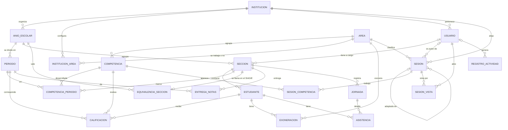

[← Volver al README Principal](../../README.md)

# 11. Base de datos

| Campo | Detalle |
|---|---|
| **Proyecto** | Sistema web para la gestión y planificación pedagógica en educación primaria – I.E. Virgen del Carmen, Huayucachi |
| **Producto** | CarpetaDocente (nombre temporal) |
| **Integrantes** | Cuicapuza Remigio Nayely Nilda · Martinez Llanos Marco Jhair · Vera Zea Jhoanna Hade |
| **Asesor** | Ing. Elvis Wilfredo Carmen Delgadillo |
| **Fecha** | 24/11/2026 |
| **Versión** | 1.4.0 |

---

## 1. Criterios de diseño

| Criterio | Decisión |
|---|---|
| Motor | PostgreSQL (documento 10) |
| Creación del esquema | Con las **migraciones de Django**, que corren en el build de Vercel. El DDL de la sección 4 describe el esquema implementado y el diseño de las tablas pendientes |
| Identificadores | Enteros grandes autoincrementales en todas las tablas. Las sesiones usan **UUID**, que también forma parte de la clave de su archivo en el almacenamiento, para que los enlaces no se puedan adivinar |
| Varias instituciones | La entidad `institucion` existe desde el inicio (documento 10, sección 4) |
| Datos personales | Del estudiante solo se guardan apellidos y nombres, con su estado. No se guarda el DNI, un código de estudiante ni la dirección IP de los usuarios (RN-015). El registro de actividad no guarda nombres, notas ni textos de justificación |
| Cierre del año escolar | Las secciones, los estudiantes, las notas y la asistencia dependen del año escolar y se eliminan en el cierre (RF-009, RN-017). Las notas y la asistencia protegen al estudiante (`RESTRICT`): durante el año no se puede borrar un estudiante con registros, así que el cierre (US-009) deberá borrar primero las notas y la asistencia. Las sesiones y el registro de actividad no dependen del año y se conservan |
| Secciones | Cada sección tiene **un solo grado**: la I.E. es polidocente completa, sin aulas multigrado (si tiene aulas multigrado: [DATO I.E. PENDIENTE]). Un docente puede tener **más de una sección**. Solo el material de referencia abarca varios grados |
| Archivos | El archivo de cada sesión se guarda en el almacenamiento de objetos. La base de datos guarda su clave, su nombre, su tipo, su tamaño y el texto extraído para la búsqueda. La plantilla del SIAGIE no se guarda |
| Texto vacío | Los campos de texto opcionales guardan cadena vacía, no `NULL` |

## 2. Modelo conceptual



## 3. Modelo lógico

PK = clave primaria · FK = clave foránea · UQ = valor único. Cada tabla indica si ya está implementada (con la historia que la creó) o si llega con una historia pendiente. Las implementadas se describen tal como están en los modelos de Django al 24/11/2026.

### 3.1. Institución y calendario

**`institucion`** (implementada: EN-01; `anexo` en US-024/025)

| Atributo | Tipo | Restricción | Descripción |
|---|---|---|---|
| id | entero grande | PK | |
| nombre | texto (200) | obligatorio | Nombre de la I.E. |
| codigo_modular | texto (20) | UQ, opcional | Código modular de la I.E. [DATO I.E. PENDIENTE]. Sin él, ninguna plantilla del SIAGIE se reconoce (RF-025) |
| anexo | entero corto | 0 a 9; 0 por defecto | Anexo del código modular, como aparece en la plantilla del SIAGIE [DATO I.E. PENDIENTE] |
| organizacion_periodos | texto (10) | BIMESTRE o TRIMESTRE, opcional | RN-006. La I.E. Virgen del Carmen organiza el año en bimestres (dato aportado por Nayely Cuicapuza, profesora de inglés y encargada del acercamiento con la I.E., el 17/10/2026) |
| creado_en | fecha y hora | obligatorio | |

**`anio_escolar`** (implementada: US-005; los campos del cierre llegan con US-009)

| Atributo | Tipo | Restricción | Descripción |
|---|---|---|---|
| id | entero grande | PK | |
| institucion_id | entero grande | FK → institucion | |
| anio | entero corto | 2026 a 2100; UQ con institucion_id | Por ejemplo, 2027 |
| estado | texto (10) | ABIERTO o CERRADO; ABIERTO por defecto | Una institución tiene **un solo año ABIERTO** a la vez (`uq_anio_escolar_abierto`) |
| consolidados_confirmados_en | fecha y hora | opcional | Por implementar (US-009): la dirección confirma que descargó los consolidados (RF-009) |
| confirmado_por_id | entero grande | FK → usuario, opcional | Por implementar (US-009) |
| conservar_hasta | fecha | opcional | Por implementar (US-009): fecha pedida por la dirección para postergar el cierre (RF-009, ruta feliz) |
| cerrado_en | fecha y hora | opcional | Por implementar (US-009) |

**`periodo`** (implementada: US-028)

| Atributo | Tipo | Restricción | Descripción |
|---|---|---|---|
| id | entero grande | PK | |
| anio_escolar_id | entero grande | FK → anio_escolar, en cascada | |
| numero | entero corto | 1 a 4; UQ con anio_escolar_id | |
| fecha_inicio, fecha_fin | fecha | fin posterior al inicio | Los periodos de un año no se cruzan: lo valida la aplicación y también la base, con la restricción de exclusión `ex_periodo_cruce` (extensión `btree_gist`) (RF-028) |

### 3.2. Usuarios, secciones y estudiantes

**`usuario`** (implementada: EN-01; `es_demo` en EN-06; modelo de usuario propio de Django)

| Atributo | Tipo | Restricción | Descripción |
|---|---|---|---|
| id | entero grande | PK | |
| username | texto (150) | UQ | Usuario para iniciar sesión |
| password | texto (128) | obligatorio | Solo el hash (RNF-012) |
| first_name, last_name | texto (150) | | Nombres y apellidos |
| email | texto (254) | opcional | |
| rol | texto (15) | DOCENTE, DIRECCION o ADMINISTRADOR | Documento 08 |
| institucion_id | entero grande | FK → institucion; obligatorio salvo para el Administrador | El administrador puede no pertenecer a una I.E. |
| is_active | booleano | | Se desactiva, no se elimina (RN-023) |
| is_staff, is_superuser | booleano | | Acceso al panel de administración de Django: solo el Administrador |
| debe_cambiar_password | booleano | | Contraseña temporal (RF-007) |
| intentos_fallidos | entero corto | | RN-024 |
| bloqueado_hasta | fecha y hora | opcional | RN-024 |
| es_demo | booleano | falso por defecto | Cuenta de la demostración (`cargar_demo`); su actividad no cuenta en los indicadores (documento 07, sección 5) |
| last_login, date_joined | fecha y hora | | Campos estándar de Django |

**`seccion`** (implementada: US-005)

| Atributo | Tipo | Restricción | Descripción |
|---|---|---|---|
| id | entero grande | PK | |
| anio_escolar_id | entero grande | FK → anio_escolar, en cascada | |
| grado | entero corto | 1 a 6 | |
| nombre | texto (20) | UQ con anio_escolar_id y grado | Por ejemplo, "A" o "Única" |
| docente_id | entero grande | FK → usuario, opcional | La tutora de la sección; un docente puede tener varias secciones |

**`estudiante`** (implementada: US-006)

| Atributo | Tipo | Restricción | Descripción |
|---|---|---|---|
| id | entero grande | PK | |
| seccion_id | entero grande | FK → seccion, en cascada | |
| apellidos, nombres | texto (120) | UQ (seccion_id, apellidos, nombres) | Evita duplicados al importar (RF-006) |
| estado | texto (12) | ACTIVO, TRASLADADO o RETIRADO; ACTIVO por defecto | TRASLADADO y RETIRADO conservan sus notas y asistencia (RN-023); no se cuentan como pendientes ni entran a jornadas nuevas (RN-027) |
| fecha_estado | fecha | opcional | Fecha del último cambio de estado. Hoy ninguna pantalla la llena: llega con la historia que registre traslados y retiros |

No hay código de estudiante: la plantilla del SIAGIE se completa cruzando apellidos y nombres (RN-015, RF-025).

### 3.3. Catálogo curricular

**`area`** (implementada: EN-06)

| Atributo | Tipo | Restricción | Descripción |
|---|---|---|---|
| id | entero grande | PK | |
| codigo_siagie | texto (4) | UQ | Código del área en el registro de notas del SIAGIE (documento 09, sección 3) |
| nombre | texto (80) | UQ | Nombre del SIAGIE, con mayúsculas normales |
| es_transversal | booleano | | Competencias transversales (RN-008) |
| admite_exoneracion | booleano | | Verdadero solo para Educación Religiosa y Educación Física (RN-010) |
| orden | entero corto | | Orden del SIAGIE (1 a 11) |

**`competencia`** (implementada: EN-06)

| Atributo | Tipo | Restricción | Descripción |
|---|---|---|---|
| id | entero grande | PK | |
| area_id | entero grande | FK → area | |
| nombre | texto (250) | UQ con area_id | Texto de la LEYENDA del SIAGIE |
| orden | entero corto | | Orden en la LEYENDA (01…n) |
| activa | booleano | | Se desactiva, no se elimina (RF-027) |

**`institucion_area`** (implementada: EN-06; `a_cargo_docente_curso` en US-029)

| Atributo | Tipo | Restricción | Descripción |
|---|---|---|---|
| id | entero grande | PK | |
| institucion_id | entero grande | FK → institucion, en cascada; UQ con area_id | |
| area_id | entero grande | FK → area | |
| se_trabaja | booleano | verdadero por defecto | Falso para las áreas que la I.E. no imparte (RN-007): Castellano como segunda lengua |
| a_cargo_docente_curso | booleano | falso por defecto | El área la califica el docente de curso y no la tutora (RF-029) |

### 3.4. Dimensión 1: repositorio de sesiones

**`sesion`** (implementada: US-010, US-011 y US-018; adaptadas con US-013)

| Atributo | Tipo | Restricción | Descripción |
|---|---|---|---|
| id | UUID | PK | Lo genera el navegador al abrir el formulario; un reintento usa el mismo |
| institucion_id | entero grande | FK → institucion | |
| autor_id | entero grande | FK → usuario; obligatorio salvo en material de referencia | La docente autora |
| subido_por_id | entero grande | FK → usuario | Docente o administrador (RF-018) |
| grado | entero corto | 1 a 6 | Grado de la sesión, o grado inicial del material de referencia |
| grado_hasta | entero corto | igual a `grado` salvo en material de referencia; `grado` ≤ `grado_hasta` ≤ 6 | Grado final: solo el material de referencia abarca varios grados (RF-018) |
| area_id | entero grande | FK → area | Área de la sesión |
| titulo | texto (200) | obligatorio, no vacío | |
| proposito | texto (hasta 1000, lo limita la aplicación) | opcional; cadena vacía si falta | |
| origen | texto (12) | PROPIA o REFERENCIA | ADAPTADA llega con US-013 |
| estado | texto (12) | ENVIADA en las propias; vacío en el material de referencia | Toda sesión propia se entrega a la dirección (RN-019) |
| compartida | booleano | | Visible en el repositorio para los demás docentes. El material de referencia siempre está compartido |
| sesion_origen_id | UUID | FK → sesion, opcional | Por implementar (US-013): sesión de la que se adaptó |
| fuente, permiso_uso | texto (300) | obligatorios en material de referencia; cadena vacía en las propias | RN-020 |
| archivo_clave | texto (300) | UQ | `sesiones/<UUID>-<token>.pdf` o `.docx`, sin datos de la docente |
| archivo_nombre | texto (255) | obligatorio | Nombre original |
| tipo_mime | texto (100) | PDF o Word (.docx) | RN-021 |
| tamano_bytes | entero | 1 a 4 194 304 (4 MB) | RNF-004 |
| terminos_aceptados_en | fecha y hora | obligatorio si la sesión propia está compartida; vacío en material de referencia | RN-019. Se conserva si la autora deja de compartirla |
| texto | texto | cadena vacía si no se pudo extraer | Texto transcrito del archivo |
| texto_busqueda | texto | | `texto`, título y propósito normalizados (sin tildes ni mayúsculas) para la búsqueda (RF-011) |
| creado_en, actualizado_en | fecha y hora | | |

**`sesion_vista`** (implementada: US-011)

| Atributo | Tipo | Restricción | Descripción |
|---|---|---|---|
| id | entero grande | PK | |
| sesion_id | UUID | FK → sesion, en cascada; UQ con usuario_id | |
| usuario_id | entero grande | FK → usuario | Docente que abrió por primera vez una sesión ajena ("Colegas que la vieron") |
| creado_en | fecha y hora | | |

**`sesion_competencia`** (por implementar; ninguna historia la pide todavía): una sesión podría trabajar varias competencias, incluso de áreas distintas.

| Atributo | Tipo | Restricción |
|---|---|---|
| id | entero grande | PK |
| sesion_id | UUID | FK → sesion, en cascada; UQ con competencia_id |
| competencia_id | entero grande | FK → competencia |

### 3.5. Dimensión 2: registro y control de notas

**`competencia_periodo`** (implementada: US-029; competencias desarrolladas por sección y periodo; RF-029, RN-004)

| Atributo | Tipo | Restricción |
|---|---|---|
| id | entero grande | PK |
| seccion_id | entero grande | FK → seccion, en cascada |
| periodo_id | entero grande | FK → periodo, en cascada |
| competencia_id | entero grande | FK → competencia; UQ (seccion_id, periodo_id, competencia_id) |

Desmarcar una competencia borra su fila, salvo que tenga notas en ese periodo (RF-029).

**`calificacion`** (implementada: US-020 a US-022)

| Atributo | Tipo | Restricción | Descripción |
|---|---|---|---|
| id | entero grande | PK | |
| estudiante_id | entero grande | FK → estudiante; no se borra un estudiante con notas | |
| competencia_id | entero grande | FK → competencia | |
| periodo_id | entero grande | FK → periodo, en cascada | |
| nivel | texto (2) | AD, A, B o C | RN-001 |
| conclusion_descriptiva | texto | de 10 a 500 caracteres si el nivel es B o C; cadena vacía si es AD o A (`ck_calificacion_conclusion`) | RN-003 |
| registrado_por_id | entero grande | FK → usuario, opcional | |
| creado_en, actualizado_en | fecha y hora | | |
| | | UQ (estudiante_id, competencia_id, periodo_id) | Una nota por estudiante, competencia y periodo (RN-002) |

Nota: la I.E. registra solo con la escala AD, A, B, C; no se guardan notas numéricas (dato aportado por Nayely Cuicapuza, profesora de inglés y encargada del acercamiento con la I.E., el 17/10/2026).

**`exoneracion`** (por implementar: US-035; RF-035, RN-010)

| Atributo | Tipo | Restricción | Descripción |
|---|---|---|---|
| id | entero grande | PK | |
| estudiante_id | entero grande | FK → estudiante; no se borra un estudiante con exoneraciones | |
| area_id | entero grande | FK → area | Solo áreas con admite_exoneracion; lo valida la aplicación |
| fecha_inicio | fecha | obligatorio | |
| fecha_fin | fecha | opcional; posterior o igual al inicio | Vacía = exoneración por todo el año |

**`entrega_notas`** (por implementar: US-026; RF-026, RF-042, RN-022)

| Atributo | Tipo | Restricción |
|---|---|---|
| id | entero grande | PK |
| seccion_id | entero grande | FK → seccion, en cascada |
| periodo_id | entero grande | FK → periodo, en cascada; UQ con seccion_id |
| estado | texto (15) | PENDIENTE, ENTREGADO o EN_CORRECCION |
| entregado_en | fecha y hora | opcional |
| habilitado_por_id | entero grande | FK → usuario, opcional |
| habilitado_en | fecha y hora | opcional |

**`equivalencia_seccion`** (implementada: US-024/025; RF-025)

| Atributo | Tipo | Restricción | Descripción |
|---|---|---|---|
| id | entero grande | PK | |
| seccion_id | entero grande | FK → seccion, en cascada; UQ | Una equivalencia por sección de la I.E. |
| anio_escolar_id | entero grande | FK → anio_escolar, en cascada | |
| grado | entero corto | | |
| codigo_siagie, nombre_siagie | texto (4), texto (60) | UQ (anio_escolar_id, grado, codigo_siagie, nombre_siagie) | Sección como la nombra el SIAGIE, por ejemplo "TRIUNFADORES" |
| creado_por_id | entero grande | FK → usuario, opcional | Usuario de la dirección que eligió la sección |
| creado_en | fecha y hora | | |

### 3.6. Dimensión 3: control de asistencia

**`jornada`** (implementada: US-030; RF-032, RN-012)

| Atributo | Tipo | Restricción |
|---|---|---|
| id | entero grande | PK |
| seccion_id | entero grande | FK → seccion, en cascada |
| fecha | fecha | UQ con seccion_id |
| registrado_por_id | entero grande | FK → usuario |
| creado_en | fecha y hora | |

La jornada no guarda si está completa o incompleta (RN-012): se calcula al consultarla. Está completa cuando todos los estudiantes con estado ACTIVO de la sección tienen una fila en `asistencia` para esa jornada. Guardarlo sería un dato derivable (3FN) que habría que actualizar en cada toque. El caso de los ingresos tardíos queda pendiente (documento 09, sección 6).

**`asistencia`** (implementada: US-030; RF-030, RF-031, RN-011)

| Atributo | Tipo | Restricción |
|---|---|---|
| id | entero grande | PK |
| jornada_id | entero grande | FK → jornada, en cascada |
| estudiante_id | entero grande | FK → estudiante; no se borra un estudiante con asistencia; UQ con jornada_id |
| estado | texto (12) | ASISTIO, FALTO, TARDE o JUSTIFICADO |
| nota_justificacion | texto (100) | Cadena vacía salvo con estado JUSTIFICADO (RN-026). Al cambiar a otro estado, la nota se borra |
| actualizado_en | fecha y hora | Última corrección (RF-031) |

### 3.7. Transversal

**`registro_actividad`** (implementada: US-008; RF-008, RNF-016)

| Atributo | Tipo | Restricción | Descripción |
|---|---|---|---|
| id | entero grande | PK | |
| usuario_id | entero grande | FK → usuario, opcional | Vacío si la operación la hizo un comando de consola |
| fecha_hora | fecha y hora | obligatorio | |
| operacion | texto (40) | una del catálogo cerrado (`ck` sobre la lista de operaciones) | Por ejemplo, INICIO_SESION, ASISTENCIA_CAMBIADA, SESION_ENVIADA, INTENTO_SIN_PERMISO |
| entidad | texto (60) | cadena vacía si no aplica | Tabla afectada |
| entidad_id | texto (40) | cadena vacía si no aplica | Sin clave foránea: el registro sobrevive al borrado de lo que registra |
| detalle | JSON | objeto vacío por defecto | **No incluye nombres de estudiantes, notas ni textos de justificación** (RN-015) |

Django agrega además sus tablas internas: permisos, grupos, sesiones de navegador, registro del panel de administración y control de migraciones.

### 3.8. Tercera forma normal

| Condición | Cómo se cumple |
|---|---|
| **1FN** (valores atómicos, sin grupos repetidos) | Las competencias de una sesión irían en `sesion_competencia`, no en una lista dentro de `sesion`. Cada estado de asistencia es una fila |
| **2FN** (dependencia de la clave completa) | En las tablas con clave única compuesta (calificacion, asistencia, competencia_periodo), cada atributo depende de la combinación completa. Por ejemplo, el nivel depende de estudiante, competencia y periodo juntos |
| **3FN** (sin dependencias transitivas) | El grado y el docente están en `seccion`, no en `estudiante`. El área de una nota se obtiene a través de la competencia, no se guarda en `calificacion`. La jornada no guarda si está completa. `sesion.texto_busqueda` es la única redundancia aceptada: se deriva de `texto`, título y propósito para que la búsqueda no recalcule la normalización en cada consulta |

## 4. Modelo físico (PostgreSQL)

DDL de referencia, escrito a mano a partir de los modelos de Django al 24/11/2026. Las tablas marcadas «por implementar» son el diseño previsto para su historia. Las diferencias de forma con lo que generan las migraciones están en la sección 8.

```sql
-- Extensión para la restricción de exclusión de periodos (RF-028)
CREATE EXTENSION IF NOT EXISTS btree_gist;

-- 3.1 Institución y calendario
CREATE TABLE institucion (
    id                     BIGSERIAL PRIMARY KEY,
    nombre                 VARCHAR(200) NOT NULL,
    codigo_modular         VARCHAR(20) UNIQUE,
    anexo                  SMALLINT NOT NULL DEFAULT 0,
    organizacion_periodos  VARCHAR(10),
    creado_en              TIMESTAMPTZ NOT NULL,
    CONSTRAINT ck_institucion_organizacion_periodos
        CHECK (organizacion_periodos IN ('BIMESTRE', 'TRIMESTRE') OR organizacion_periodos IS NULL),
    CONSTRAINT ck_institucion_anexo CHECK (anexo BETWEEN 0 AND 9)
);

CREATE TABLE usuario (
    id                     BIGSERIAL PRIMARY KEY,
    username               VARCHAR(150) NOT NULL UNIQUE,
    password               VARCHAR(128) NOT NULL,
    first_name             VARCHAR(150) NOT NULL,
    last_name              VARCHAR(150) NOT NULL,
    email                  VARCHAR(254) NOT NULL,
    rol                    VARCHAR(15) NOT NULL,
    institucion_id         BIGINT REFERENCES institucion(id) ON DELETE RESTRICT,
    is_active              BOOLEAN NOT NULL,
    is_staff               BOOLEAN NOT NULL,
    is_superuser           BOOLEAN NOT NULL,
    debe_cambiar_password  BOOLEAN NOT NULL,
    intentos_fallidos      SMALLINT NOT NULL,
    bloqueado_hasta        TIMESTAMPTZ,
    es_demo                BOOLEAN NOT NULL,
    last_login             TIMESTAMPTZ,
    date_joined            TIMESTAMPTZ NOT NULL,
    CONSTRAINT ck_usuario_rol CHECK (rol IN ('DOCENTE', 'DIRECCION', 'ADMINISTRADOR')),
    CONSTRAINT ck_usuario_institucion CHECK (rol = 'ADMINISTRADOR' OR institucion_id IS NOT NULL)
);

CREATE TABLE anio_escolar (
    id              BIGSERIAL PRIMARY KEY,
    institucion_id  BIGINT NOT NULL REFERENCES institucion(id) ON DELETE RESTRICT,
    anio            SMALLINT NOT NULL,
    estado          VARCHAR(10) NOT NULL,
    -- Por implementar (US-009):
    -- consolidados_confirmados_en TIMESTAMPTZ, confirmado_por_id BIGINT REFERENCES usuario(id)
    -- ON DELETE SET NULL, conservar_hasta DATE, cerrado_en TIMESTAMPTZ
    CONSTRAINT uq_anio_escolar UNIQUE (institucion_id, anio),
    CONSTRAINT ck_anio_escolar_anio CHECK (anio BETWEEN 2026 AND 2100),
    CONSTRAINT ck_anio_escolar_estado CHECK (estado IN ('ABIERTO', 'CERRADO'))
);
CREATE UNIQUE INDEX uq_anio_escolar_abierto ON anio_escolar (institucion_id) WHERE estado = 'ABIERTO';

CREATE TABLE periodo (
    id               BIGSERIAL PRIMARY KEY,
    anio_escolar_id  BIGINT NOT NULL REFERENCES anio_escolar(id) ON DELETE CASCADE,
    numero           SMALLINT NOT NULL,
    fecha_inicio     DATE NOT NULL,
    fecha_fin        DATE NOT NULL,
    CONSTRAINT uq_periodo UNIQUE (anio_escolar_id, numero),
    CONSTRAINT ck_periodo_numero CHECK (numero BETWEEN 1 AND 4),
    CONSTRAINT ck_periodo_fechas CHECK (fecha_fin > fecha_inicio),
    CONSTRAINT ex_periodo_cruce EXCLUDE USING gist (
        daterange(fecha_inicio, fecha_fin, '[]') WITH &&,
        anio_escolar_id WITH =
    ) DEFERRABLE INITIALLY DEFERRED
);

-- 3.2 Secciones y estudiantes
CREATE TABLE seccion (
    id               BIGSERIAL PRIMARY KEY,
    anio_escolar_id  BIGINT NOT NULL REFERENCES anio_escolar(id) ON DELETE CASCADE,
    grado            SMALLINT NOT NULL,
    nombre           VARCHAR(20) NOT NULL,
    docente_id       BIGINT REFERENCES usuario(id) ON DELETE RESTRICT,
    CONSTRAINT uq_seccion UNIQUE (anio_escolar_id, grado, nombre),
    CONSTRAINT ck_seccion_grado CHECK (grado BETWEEN 1 AND 6)
);

CREATE TABLE estudiante (
    id            BIGSERIAL PRIMARY KEY,
    seccion_id    BIGINT NOT NULL REFERENCES seccion(id) ON DELETE CASCADE,
    apellidos     VARCHAR(120) NOT NULL,
    nombres       VARCHAR(120) NOT NULL,
    estado        VARCHAR(12) NOT NULL,
    fecha_estado  DATE,
    CONSTRAINT uq_estudiante UNIQUE (seccion_id, apellidos, nombres),
    CONSTRAINT ck_estudiante_estado CHECK (estado IN ('ACTIVO', 'TRASLADADO', 'RETIRADO'))
);

-- 3.3 Catálogo curricular
CREATE TABLE area (
    id                  BIGSERIAL PRIMARY KEY,
    codigo_siagie       VARCHAR(4) NOT NULL UNIQUE,
    nombre              VARCHAR(80) NOT NULL UNIQUE,
    es_transversal      BOOLEAN NOT NULL,
    admite_exoneracion  BOOLEAN NOT NULL,
    orden               SMALLINT NOT NULL
);

CREATE TABLE competencia (
    id       BIGSERIAL PRIMARY KEY,
    area_id  BIGINT NOT NULL REFERENCES area(id) ON DELETE RESTRICT,
    nombre   VARCHAR(250) NOT NULL,
    orden    SMALLINT NOT NULL,
    activa   BOOLEAN NOT NULL,
    CONSTRAINT uq_competencia UNIQUE (area_id, nombre)
);

CREATE TABLE institucion_area (
    id                     BIGSERIAL PRIMARY KEY,
    institucion_id         BIGINT NOT NULL REFERENCES institucion(id) ON DELETE CASCADE,
    area_id                BIGINT NOT NULL REFERENCES area(id) ON DELETE RESTRICT,
    se_trabaja             BOOLEAN NOT NULL,
    a_cargo_docente_curso  BOOLEAN NOT NULL DEFAULT FALSE,
    CONSTRAINT uq_institucion_area UNIQUE (institucion_id, area_id)
);

-- 3.4 Dimensión 1: repositorio de sesiones
CREATE TABLE sesion (
    id                     UUID PRIMARY KEY,
    institucion_id         BIGINT NOT NULL REFERENCES institucion(id) ON DELETE RESTRICT,
    autor_id               BIGINT REFERENCES usuario(id) ON DELETE RESTRICT,
    subido_por_id          BIGINT NOT NULL REFERENCES usuario(id) ON DELETE RESTRICT,
    grado                  SMALLINT NOT NULL,
    grado_hasta            SMALLINT,
    area_id                BIGINT NOT NULL REFERENCES area(id) ON DELETE RESTRICT,
    titulo                 VARCHAR(200) NOT NULL,
    proposito              TEXT NOT NULL,
    origen                 VARCHAR(12) NOT NULL,
    estado                 VARCHAR(12) NOT NULL,
    compartida             BOOLEAN NOT NULL,
    -- Por implementar (US-013): sesion_origen_id UUID REFERENCES sesion(id) ON DELETE SET NULL
    fuente                 VARCHAR(300) NOT NULL DEFAULT '',
    permiso_uso            VARCHAR(300) NOT NULL DEFAULT '',
    archivo_clave          VARCHAR(300) NOT NULL,
    archivo_nombre         VARCHAR(255) NOT NULL,
    tipo_mime              VARCHAR(100) NOT NULL,
    tamano_bytes           INTEGER NOT NULL,
    terminos_aceptados_en  TIMESTAMPTZ,
    texto                  TEXT NOT NULL DEFAULT '',
    texto_busqueda         TEXT NOT NULL DEFAULT '',
    creado_en              TIMESTAMPTZ NOT NULL,
    actualizado_en         TIMESTAMPTZ NOT NULL,
    CONSTRAINT uq_sesion_archivo_clave UNIQUE (archivo_clave),
    CONSTRAINT ck_sesion_grado CHECK (grado >= 1 AND grado <= grado_hasta AND grado_hasta <= 6),
    CONSTRAINT ck_sesion_un_grado CHECK (origen = 'REFERENCIA' OR grado_hasta = grado),
    CONSTRAINT ck_sesion_origen CHECK (origen IN ('PROPIA', 'REFERENCIA')),
    CONSTRAINT ck_sesion_estado CHECK (
        (estado = '' AND origen = 'REFERENCIA')
        OR (origen <> 'REFERENCIA' AND estado IN ('ENVIADA'))
    ),
    CONSTRAINT ck_sesion_autor CHECK (
        (autor_id IS NULL AND origen = 'REFERENCIA')
        OR (origen <> 'REFERENCIA' AND autor_id IS NOT NULL)
    ),
    CONSTRAINT ck_sesion_referencia CHECK (
        origen <> 'REFERENCIA'
        OR (compartida AND terminos_aceptados_en IS NULL AND fuente <> '' AND permiso_uso <> '')
    ),
    CONSTRAINT ck_sesion_tipo_mime CHECK (tipo_mime IN (
        'application/pdf',
        'application/vnd.openxmlformats-officedocument.wordprocessingml.document')),
    CONSTRAINT ck_sesion_tamano CHECK (tamano_bytes BETWEEN 1 AND 4194304),
    CONSTRAINT ck_sesion_titulo CHECK (titulo <> ''),
    CONSTRAINT ck_sesion_terminos CHECK (
        NOT compartida OR terminos_aceptados_en IS NOT NULL OR origen = 'REFERENCIA'
    )
);

CREATE TABLE sesion_vista (
    id          BIGSERIAL PRIMARY KEY,
    sesion_id   UUID NOT NULL REFERENCES sesion(id) ON DELETE CASCADE,
    usuario_id  BIGINT NOT NULL REFERENCES usuario(id) ON DELETE RESTRICT,
    creado_en   TIMESTAMPTZ NOT NULL,
    CONSTRAINT uq_sesion_vista UNIQUE (sesion_id, usuario_id)
);

-- Por implementar (sin historia todavía)
CREATE TABLE sesion_competencia (
    id              BIGSERIAL PRIMARY KEY,
    sesion_id       UUID NOT NULL REFERENCES sesion(id) ON DELETE CASCADE,
    competencia_id  BIGINT NOT NULL REFERENCES competencia(id) ON DELETE RESTRICT,
    CONSTRAINT uq_sesion_competencia UNIQUE (sesion_id, competencia_id)
);

-- 3.5 Dimensión 2: registro y control de notas
CREATE TABLE competencia_periodo (
    id              BIGSERIAL PRIMARY KEY,
    seccion_id      BIGINT NOT NULL REFERENCES seccion(id) ON DELETE CASCADE,
    periodo_id      BIGINT NOT NULL REFERENCES periodo(id) ON DELETE CASCADE,
    competencia_id  BIGINT NOT NULL REFERENCES competencia(id) ON DELETE RESTRICT,
    CONSTRAINT uq_competencia_periodo UNIQUE (seccion_id, periodo_id, competencia_id)
);

CREATE TABLE calificacion (
    id                      BIGSERIAL PRIMARY KEY,
    estudiante_id           BIGINT NOT NULL REFERENCES estudiante(id) ON DELETE RESTRICT,
    competencia_id          BIGINT NOT NULL REFERENCES competencia(id) ON DELETE RESTRICT,
    periodo_id              BIGINT NOT NULL REFERENCES periodo(id) ON DELETE CASCADE,
    nivel                   VARCHAR(2) NOT NULL,
    conclusion_descriptiva  TEXT NOT NULL,
    registrado_por_id       BIGINT REFERENCES usuario(id) ON DELETE SET NULL,
    creado_en               TIMESTAMPTZ NOT NULL,
    actualizado_en          TIMESTAMPTZ NOT NULL,
    CONSTRAINT uq_calificacion UNIQUE (estudiante_id, competencia_id, periodo_id),
    CONSTRAINT ck_calificacion_nivel CHECK (nivel IN ('AD', 'A', 'B', 'C')),
    CONSTRAINT ck_calificacion_conclusion CHECK (
        (nivel NOT IN ('AD', 'A') OR conclusion_descriptiva = '')
        AND (nivel NOT IN ('B', 'C') OR length(conclusion_descriptiva) BETWEEN 10 AND 500)
    )
);

-- Por implementar (US-035)
CREATE TABLE exoneracion (
    id             BIGSERIAL PRIMARY KEY,
    estudiante_id  BIGINT NOT NULL REFERENCES estudiante(id) ON DELETE RESTRICT,
    area_id        BIGINT NOT NULL REFERENCES area(id) ON DELETE RESTRICT,
    fecha_inicio   DATE NOT NULL,
    fecha_fin      DATE,
    CONSTRAINT ck_exoneracion_fechas CHECK (fecha_fin IS NULL OR fecha_fin >= fecha_inicio)
);

-- Por implementar (US-026)
CREATE TABLE entrega_notas (
    id                 BIGSERIAL PRIMARY KEY,
    seccion_id         BIGINT NOT NULL REFERENCES seccion(id) ON DELETE CASCADE,
    periodo_id         BIGINT NOT NULL REFERENCES periodo(id) ON DELETE CASCADE,
    estado             VARCHAR(15) NOT NULL DEFAULT 'PENDIENTE'
                       CHECK (estado IN ('PENDIENTE', 'ENTREGADO', 'EN_CORRECCION')),
    entregado_en       TIMESTAMPTZ,
    habilitado_por_id  BIGINT REFERENCES usuario(id) ON DELETE SET NULL,
    habilitado_en      TIMESTAMPTZ,
    CONSTRAINT uq_entrega_notas UNIQUE (seccion_id, periodo_id)
);

CREATE TABLE equivalencia_seccion (
    id               BIGSERIAL PRIMARY KEY,
    seccion_id       BIGINT NOT NULL UNIQUE REFERENCES seccion(id) ON DELETE CASCADE,
    anio_escolar_id  BIGINT NOT NULL REFERENCES anio_escolar(id) ON DELETE CASCADE,
    grado            SMALLINT NOT NULL,
    codigo_siagie    VARCHAR(4) NOT NULL,
    nombre_siagie    VARCHAR(60) NOT NULL,
    creado_por_id    BIGINT REFERENCES usuario(id) ON DELETE SET NULL,
    creado_en        TIMESTAMPTZ NOT NULL,
    CONSTRAINT uq_equivalencia_seccion_siagie UNIQUE (anio_escolar_id, grado, codigo_siagie, nombre_siagie)
);

-- 3.6 Dimensión 3: control de asistencia
CREATE TABLE jornada (
    id                 BIGSERIAL PRIMARY KEY,
    seccion_id         BIGINT NOT NULL REFERENCES seccion(id) ON DELETE CASCADE,
    fecha              DATE NOT NULL,
    registrado_por_id  BIGINT NOT NULL REFERENCES usuario(id) ON DELETE RESTRICT,
    creado_en          TIMESTAMPTZ NOT NULL,
    CONSTRAINT uq_jornada UNIQUE (seccion_id, fecha)
);

CREATE TABLE asistencia (
    id                  BIGSERIAL PRIMARY KEY,
    jornada_id          BIGINT NOT NULL REFERENCES jornada(id) ON DELETE CASCADE,
    estudiante_id       BIGINT NOT NULL REFERENCES estudiante(id) ON DELETE RESTRICT,
    estado              VARCHAR(12) NOT NULL,
    nota_justificacion  VARCHAR(100) NOT NULL,
    actualizado_en      TIMESTAMPTZ NOT NULL,
    CONSTRAINT uq_asistencia UNIQUE (jornada_id, estudiante_id),
    CONSTRAINT ck_asistencia_estado CHECK (estado IN ('ASISTIO', 'FALTO', 'TARDE', 'JUSTIFICADO')),
    CONSTRAINT ck_asistencia_nota CHECK (nota_justificacion = '' OR estado = 'JUSTIFICADO')
);

-- 3.7 Transversal
CREATE TABLE registro_actividad (
    id          BIGSERIAL PRIMARY KEY,
    usuario_id  BIGINT REFERENCES usuario(id) ON DELETE SET NULL,
    fecha_hora  TIMESTAMPTZ NOT NULL,
    operacion   VARCHAR(40) NOT NULL,   -- CHECK con la lista cerrada del catálogo (spec registro-actividad)
    entidad     VARCHAR(60) NOT NULL,
    entidad_id  VARCHAR(40) NOT NULL,
    detalle     JSONB NOT NULL
);

-- Índices (además de los que crean UNIQUE y las claves foráneas)
CREATE INDEX idx_sesion_busqueda             ON sesion (institucion_id, grado, area_id);
CREATE INDEX idx_sesion_autor_fecha          ON sesion (autor_id, creado_en DESC);
CREATE INDEX idx_calificacion_periodo        ON calificacion (periodo_id, competencia_id);
CREATE INDEX idx_actividad_fecha             ON registro_actividad (fecha_hora);
CREATE INDEX idx_actividad_usuario_fecha     ON registro_actividad (usuario_id, fecha_hora);
CREATE INDEX idx_actividad_operacion_fecha   ON registro_actividad (operacion, fecha_hora);
```

La búsqueda de sesiones (RF-011) compara sobre `texto_busqueda` ya normalizado, sin la extensión `pg_trgm`: con el volumen esperado (sección 7) no hace falta un índice de trigramas.

## 5. Reglas que valida la aplicación

Estas reglas comparan datos de más de una tabla, así que no se expresan con un CHECK simple. Las valida la capa de servicios (documento 10, sección 4):

| Regla | Origen |
|---|---|
| La sección y el periodo de una nota o de una competencia trabajada pertenecen al mismo año escolar | RN-004 |
| Solo se registra nota en competencias marcadas como trabajadas en el periodo, y no en áreas a cargo del docente de curso | RF-029, RN-004 |
| No se desmarca una competencia que ya tiene notas en el periodo | RF-029 |
| No se registra nota a un estudiante exonerado en las competencias de esa área (por implementar, US-035) | RF-035, RN-010 |
| La exoneración solo aplica a áreas con admite_exoneracion (por implementar, US-035) | RN-010 |
| No se editan notas de un periodo entregado salvo que la dirección habilite la corrección (por implementar, US-026) | RF-026, RN-022 |
| El cierre del año exige la confirmación de la dirección (por implementar, US-009) | RF-009, RN-017 |
| Al eliminar una sesión también se elimina su archivo del almacenamiento, y si la sesión no se guarda, su archivo se borra | RF-016, RF-010 |
| Cada escritura deja su entrada en `registro_actividad` en la misma transacción | RF-008, RNF-016 |

Que los periodos de un año no se crucen ya no es solo una regla de la aplicación: también la impone la base con `ex_periodo_cruce` (sección 4).

## 6. Datos iniciales

| Tabla | Contenido | Origen |
|---|---|---|
| `area`, `competencia` | Las 11 áreas del registro de notas del SIAGIE, con su código, nombre, orden y competencias; admite_exoneracion en Educación Religiosa y Educación Física; es_transversal en los dos bloques transversales. Se cargan con la migración `catalogo/0002` | Documento 09, sección 3 |
| `institucion_area` | Cada institución recibe las 11 áreas: todas «se trabaja» salvo Castellano como segunda lengua, y ninguna a cargo del docente de curso. El Administrador las ajusta en el panel | Decisión 5 de EN-06 (30/10/2026) |
| `institucion` | I.E. Virgen del Carmen – Huayucachi | Código modular y anexo: [DATO I.E. PENDIENTE]; organización de periodos: bimestral (sección 3.1) |
| `usuario` | Una cuenta de Administrador para el equipo | — |
| Demostración | Comando `cargar_demo`: cuentas `es_demo`, secciones, estudiantes, notas y asistencia **ficticios**; `quitar_demo` los borra | RN-018; spec `datos-demostracion` |

## 7. Volumen esperado

| Tabla | Filas por año escolar |
|---|---|
| `calificacion` | estudiantes × competencias trabajadas × periodos |
| `asistencia` | estudiantes × jornadas lectivas |
| `sesion` | Crece con los aportes; no se reinicia al cerrar el año |
| `registro_actividad` | Una fila por escritura, inicio o cierre de sesión, vista o descarga registrada; no se reinicia al cerrar el año |

El número de estudiantes y secciones de la I.E. es un [DATO I.E. PENDIENTE]. Con cualquier valor realista para un colegio, el volumen queda muy por debajo del 1 GB del plan gratuito de la base de datos, porque los archivos de sesiones van al almacenamiento de objetos.

## 8. Implementación en Django: diferencias con el DDL

El esquema se crea con las migraciones de Django (sección 1). Las migraciones reproducen las columnas, los tipos y longitudes, la obligatoriedad, las claves únicas, las claves foráneas, las restricciones `CHECK` y la exclusión de periodos de las tablas implementadas (8.1). Estas son las diferencias de forma:

| N.° | Aspecto | DDL (sección 4) | Implementación en Django | Efecto |
|---|---|---|---|---|
| 1 | Valores por defecto | `DEFAULT` solo donde la base lo tiene | La aplicación asigna los demás valores al guardar. Tienen `DEFAULT` en la base solo las columnas agregadas a tablas con datos (`anexo`, `a_cargo_docente_curso`, `texto`, `texto_busqueda`, `fuente`, `permiso_uso`), para que el despliegue anterior siga insertando mientras Vercel migra | Las filas insertadas con SQL fuera de la aplicación deben indicar todos los valores |
| 2 | Borrado con filas dependientes | `ON DELETE RESTRICT` | `PROTECT` o `RESTRICT` en el modelo: lo impide la aplicación, y la clave foránea de la base es `NO ACTION DEFERRABLE INITIALLY DEFERRED` | La base también rechaza el borrado, pero al confirmar la transacción y no en el momento |
| 3 | Índices de las claves foráneas | No se listan | Django crea un índice por cada clave foránea (`<tabla>_<columna>_<hash>`) | Ninguno sobre los datos |
| 4 | Índices adicionales | — | Índices `_like` (`varchar_pattern_ops`) en las columnas de texto únicas, como `username` y `codigo_modular` | Ninguno sobre los datos |
| 5 | Tablas adicionales | — | `usuario_groups` y `usuario_user_permissions` (grupos y permisos de Django) y las tablas internas de Django (`auth_*`, `django_*`) | Ninguno sobre el modelo de este documento |
| 6 | Claves primarias | `BIGSERIAL` | `bigint generated by default as identity` | Equivalentes |
| 7 | Orden de las columnas | El del DDL | El de los campos del modelo de Django y el orden de las migraciones | Ninguno |
| 8 | Tipos de texto vacíos | `NOT NULL` con cadena vacía | Igual: los campos de texto opcionales guardan `''`, no `NULL` (`proposito`, `conclusion_descriptiva`, `nota_justificacion`, `entidad`, `entidad_id`) | Las consultas buscan `''`, no `IS NULL` |
| 9 | Material de referencia | Misma tabla `sesion` | Modelo proxy `SesionReferencia` sobre `sesion`, para el panel del Administrador | Ninguno sobre los datos |

### 8.1. Tablas implementadas

| Tabla | Implementada en | Migraciones |
|---|---|---|
| `institucion` | EN-01; `anexo` en US-024/025 | `institucion/0001_initial`, `0006_institucion_anexo` |
| `usuario` | EN-01; `es_demo` en EN-06 | `cuentas/0001_initial`, `0002_usuario_es_demo` |
| `anio_escolar`, `seccion` | US-005 | `institucion/0002_anio_escolar_seccion` |
| `estudiante` | US-006 | `institucion/0003_estudiante`, `0004_estudiante_estado` |
| `periodo` | US-028 | `institucion/0005_periodo` (con `btree_gist`) |
| `area`, `competencia`, `institucion_area` | EN-06; `a_cargo_docente_curso` en US-029 | `catalogo/0001_initial`, `0002_catalogo_siagie` (datos), `0003_institucionarea_a_cargo_docente_curso` |
| `registro_actividad` | US-008; cada historia suma sus operaciones | `actividad/0001_initial` a `0008_operaciones_plantilla_siagie` |
| `jornada`, `asistencia` | US-030 | `asistencia/0001_initial` |
| `competencia_periodo` | US-029 | `notas/0001_initial` |
| `calificacion` | US-020 a US-022 | `notas/0002_calificacion` |
| `sesion` | US-010; texto y vistas en US-011; referencia en US-018 | `repositorio/0001_initial` a `0004_grado_hasta_nulo` |
| `sesion_vista` | US-011 | `repositorio/0002_texto_vistas_y_terminos` |
| `equivalencia_seccion` | US-024/025 | `exportaciones/0001_initial` |

Por implementar: `sesion_competencia` (sin historia), `exoneracion` (US-035), `entrega_notas` (US-026), los campos del cierre en `anio_escolar` (US-009) y `sesion.sesion_origen_id` (US-013).

## Historial de cambios

| Versión | Fecha | Autor | Descripción |
|---|---|---|---|
| 1.0.0 | 15/10/2026 | Equipo del proyecto | Versión inicial: modelos conceptual, lógico (3FN) y físico (PostgreSQL) con índices, reglas de validación y datos iniciales. |
| 1.1.0 | 15/10/2026 | Equipo del proyecto | Se agrega la sección 8: diferencias entre el DDL y la implementación en Django, y tablas implementadas en EN-01 (`usuario` e `institucion`). El DDL y las secciones 1 a 7 no cambian. |
| 1.2.0 | 17/10/2026 | Equipo del proyecto | `institucion.organizacion_periodos`: la I.E. organiza el año en bimestres (RN-006); el DDL no cambia. `calificacion`: nota de que la I.E. registra solo con la escala AD, A, B, C. `estudiante`: `estado` (ACTIVO, TRASLADADO o RETIRADO) y `fecha_estado` reemplazan a `activo`, en el modelo lógico y el DDL. Sección 6: organización de periodos bimestral. Sección 8: `estudiante` cambia en esta versión y aún no está implementada. |
| 1.3.0 | 19/10/2026 | Equipo del proyecto | `asistencia`: nuevo campo `nota_justificacion` (hasta 100 caracteres, opcional) con la restricción `ck_asistencia_nota`: solo con estado JUSTIFICADO (RN-026), en el modelo lógico y el DDL. `jornada`: el estado completa o incompleta se calcula al consultar y no se guarda (RN-012). `estudiante.estado` remite a RN-027. |
| 1.4.0 | 24/11/2026 | Equipo del proyecto | Pasada de docs: modelo lógico y DDL editados tabla por tabla contra los modelos de Django al 24/11/2026: anexo, año ABIERTO único, exclusión de periodos con btree_gist, es_demo, codigo_siagie, a_cargo_docente_curso, sesion con estado, compartida, grado_hasta, texto y 4 MB, sesion_vista, conclusión en B y C, RESTRICT hacia estudiante, equivalencia_seccion y registro de actividad sin NULL; tablas pendientes marcadas; datos iniciales con 11 áreas; sección 8 y tablas implementadas al día. |

[← Volver al README Principal](../../README.md)
