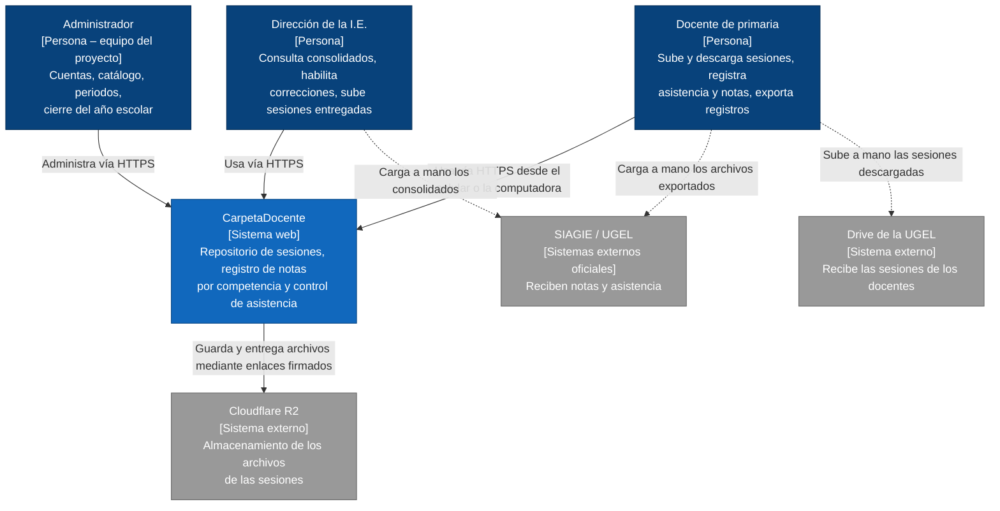
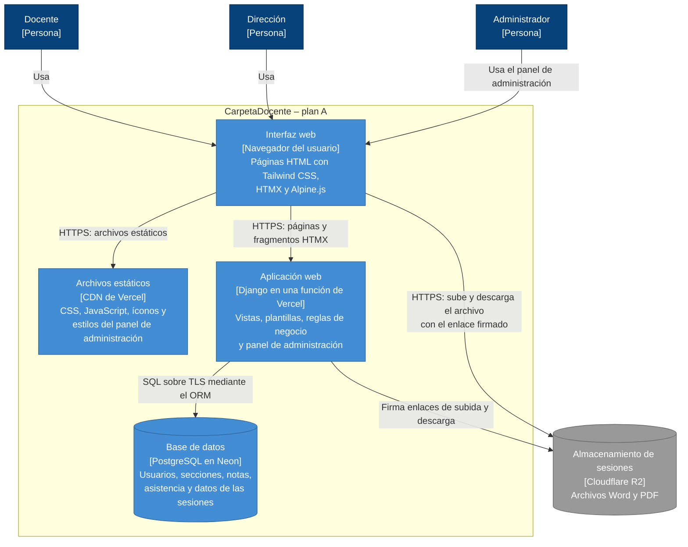
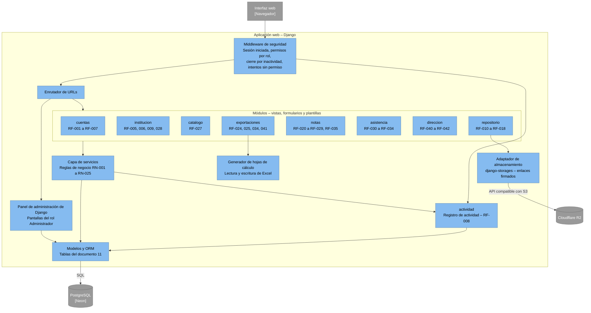
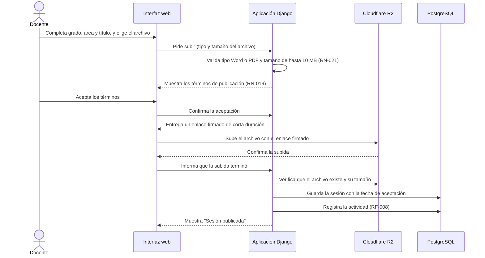
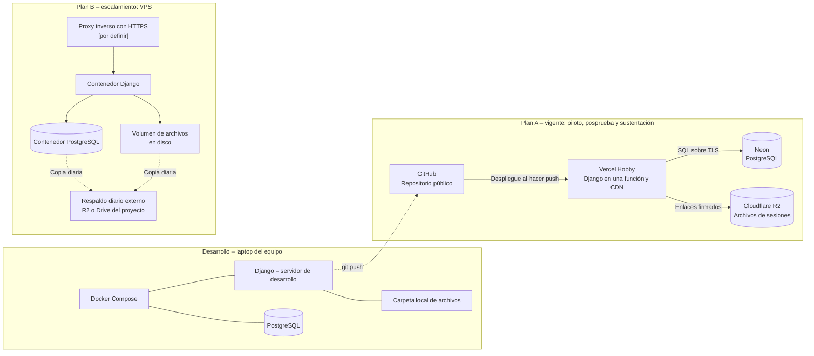

[← Volver al README Principal](../../README.md)

# 12. Modelo C4

| Campo | Detalle |
|---|---|
| **Proyecto** | Sistema web para la gestión y planificación pedagógica en educación primaria – I.E. Virgen del Carmen, Huayucachi |
| **Producto** | CarpetaDocente (nombre temporal) |
| **Integrantes** | Cuicapuza Remigio Nayely Nilda · Martinez Llanos Marco Jhair · Vera Zea Jhoanna Hade |
| **Asesor** | Ing. Elvis Wilfredo Carmen Delgadillo |
| **Fecha** | 15/10/2026 |
| **Versión** | 1.1.0 |

---

## 1. Alcance de los diagramas

Los diagramas siguen el modelo C4 en tres niveles (contexto, contenedores y componentes), más un diagrama de despliegue. Representan la arquitectura **cliente-servidor** del sistema: el navegador del docente es el cliente y la aplicación Django, con su base de datos, es el servidor. Se basan en el stack y los planes de despliegue del documento 10 y en el modelo de datos del documento 11.

**Convenciones:**
- Línea continua: comunicación directa entre el sistema y otro elemento.
- Línea punteada: intercambio **manual**, sin conexión técnica. Por ejemplo, un archivo que el docente exporta y luego carga él mismo en el SIAGIE.

## 2. Nivel 1: diagrama de contexto

| Elemento | Tipo | Relación con el sistema |
|---|---|---|
| Docente | Persona | Usuario principal (documento 08) |
| Dirección | Persona | Usuario secundario: monitoreo y consolidados |
| Administrador | Persona | Equipo del proyecto: cuentas, catálogos y cierre del año |
| Cloudflare R2 | Sistema externo | Guarda los archivos de las sesiones (documento 10) |
| SIAGIE / UGEL | Sistemas externos | **Sin conexión.** Reciben archivos cargados a mano (RES-04, RES-12) |
| Drive de la UGEL | Sistema externo | **Sin conexión.** El docente sube ahí la sesión que descargó del sistema |

## 3. Nivel 2: diagrama de contenedores

| Contenedor | Tecnología | Responsabilidad | Requisitos relacionados |
|---|---|---|---|
| Interfaz web | HTML, Tailwind CSS, HTMX y Alpine.js, generados por el servidor | Pantallas del docente y de la dirección, adaptadas al celular | RNF-002, RNF-005, RNF-007, RNF-008 |
| Archivos estáticos | CDN de Vercel | Entrega los estilos y scripts sin pasar por la aplicación | RNF-002 |
| Aplicación web | Django en una función de Vercel | Autenticación, permisos, reglas de negocio, exportaciones y panel de administración | RF-001 a RF-042; RNF-001, RNF-013 |
| Base de datos | PostgreSQL en Neon | Datos estructurados (documento 11) | RNF-010, RNF-017 |
| Almacenamiento de sesiones | Cloudflare R2 | Archivos de las sesiones, de hasta 10 MB | RNF-004 |

**Por qué el navegador habla directo con R2:** las funciones de Vercel aceptan envíos de hasta 4,5 MB, y una sesión puede pesar hasta 10 MB. La aplicación solo **firma** un enlace de corta duración; el archivo viaja del navegador a R2 sin pasar por la función (documento 10, sección 5.1).

## 4. Nivel 3: diagrama de componentes de la aplicación web

| Componente | Responsabilidad |
|---|---|
| **Middleware de seguridad** | Exige sesión iniciada, aplica la matriz de permisos del documento 08, cierra la sesión tras 60 min de inactividad (RNF-015) y registra los intentos sin permiso (RF-004) |
| **Enrutador de URLs** | Dirige cada solicitud al módulo que corresponde |
| **Módulos** (`cuentas`, `institucion`, `catalogo`, `repositorio`, `notas`, `asistencia`, `direccion`, `exportaciones`) | Vistas, formularios y plantillas de cada bloque funcional. **No contienen reglas de negocio**: las delegan en la capa de servicios |
| **Panel de administración** | Pantallas del Administrador, generadas por Django a partir de los modelos. Solo accesible con `is_staff` (documento 11) |
| **Capa de servicios** | Aplica las reglas del documento 09: escala de logro, conclusión en C, competencias por periodo, exoneraciones, bloqueo de notas entregadas, estados de asistencia, términos de publicación y cierre del año |
| **actividad** | Registra quién hizo qué y cuándo (RF-008, RNF-016) y alimenta los indicadores del documento 03 |
| **Modelos y ORM** | Representan las tablas del documento 11 y las restricciones de la base de datos |
| **Adaptador de almacenamiento** | Firma los enlaces de subida y descarga en R2 y elimina el archivo cuando se elimina la sesión (RF-016) |
| **Generador de hojas de cálculo** | Produce las exportaciones de notas y asistencia y completa el formato de la UGEL (RF-025) |

**Regla de dependencias:** las vistas llaman a los servicios, y los servicios llaman a los modelos. Las vistas no escriben directamente en la base de datos. Esto mantiene las reglas en un solo lugar y facilita una migración futura (documento 10, sección 6).

## 5. Flujo crítico: subir una sesión al repositorio

Es el único flujo en que un archivo no pasa por la aplicación.

Si el docente no acepta los términos, no se genera el enlace y no se guarda nada (RF-014, ruta infeliz). Si la subida a R2 falla, la sesión no se registra en la base de datos.

## 6. Diagrama de despliegue

| Entorno | Componentes | Uso |
|---|---|---|
| Desarrollo | Docker Compose con Django y PostgreSQL; archivos en una carpeta local | Construcción y pruebas con datos ficticios (RN-018) |
| Plan A | GitHub → Vercel (Django y CDN), Neon (PostgreSQL), Cloudflare R2 (archivos) | Piloto con docentes (2026), posprueba (2027) y sustentación; costo S/ 0 al mes |
| Plan B | VPS con Docker Compose: proxy inverso, Django, PostgreSQL y volumen de archivos, con respaldo diario externo | Si la I.E. adopta el sistema o cambian las condiciones del plan A; el proxy inverso y el proveedor del VPS se definen al activarlo |

El mismo código corre en los tres entornos. Solo cambian las variables de configuración: base de datos, almacenamiento de archivos y dominio.

## Historial de cambios

| Versión | Fecha | Autor | Descripción |
|---|---|---|---|
| 1.0.0 | 15/10/2026 | Equipo del proyecto | Versión inicial: niveles 1 a 3 del modelo C4, flujo de subida de sesiones y diagrama de despliegue. |
| 1.1.0 | 15/10/2026 | Equipo del proyecto | El diagrama de despliegue indica repositorio público. |

[← Volver al README Principal](../../README.md)
