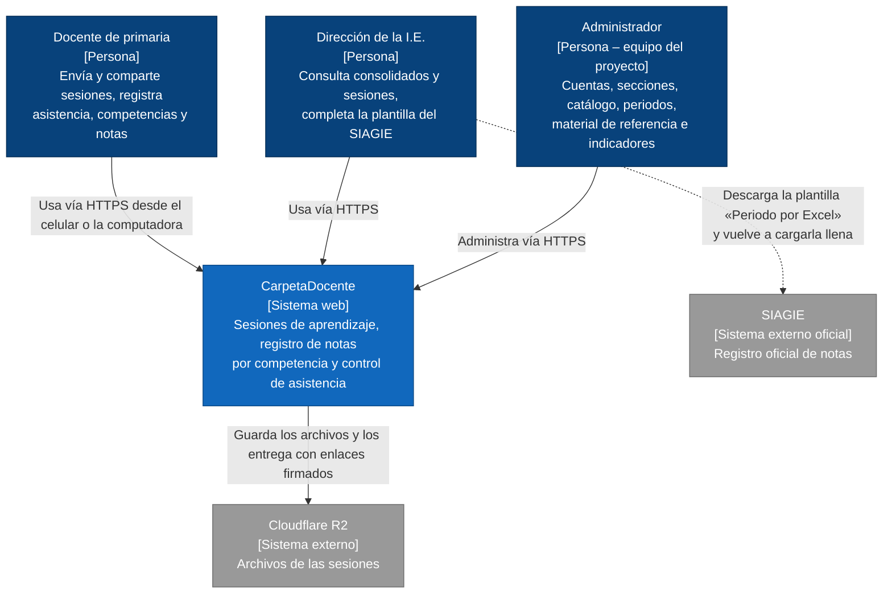
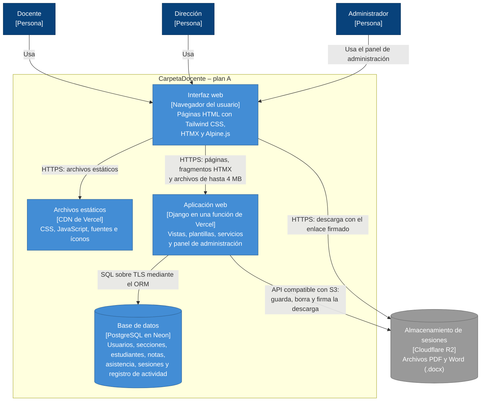
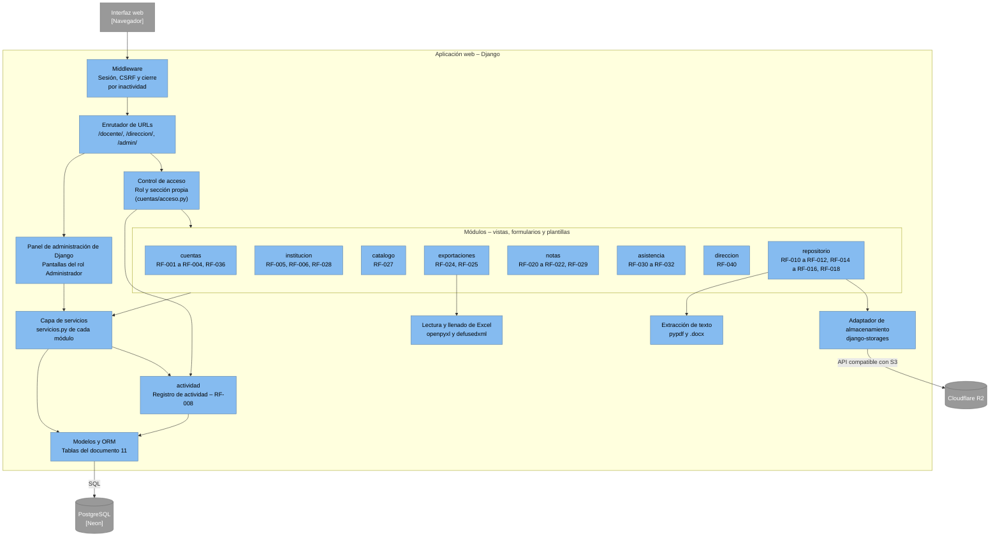
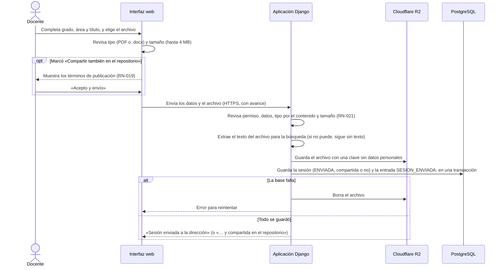
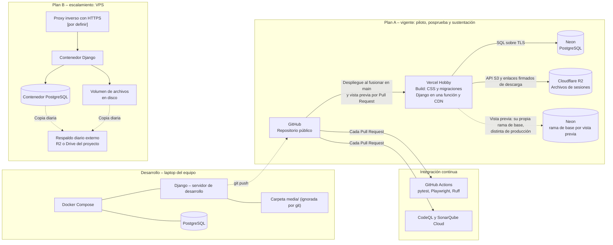

[← Volver al README Principal](../../README.md)

# 12. Modelo C4

| Campo | Detalle |
|---|---|
| **Proyecto** | Sistema web para la gestión y planificación pedagógica en educación primaria – I.E. Virgen del Carmen, Huayucachi |
| **Producto** | CarpetaDocente (nombre temporal) |
| **Integrantes** | Cuicapuza Remigio Nayely Nilda · Martinez Llanos Marco Jhair · Vera Zea Jhoanna Hade |
| **Asesor** | Ing. Elvis Wilfredo Carmen Delgadillo |
| **Fecha** | 25/11/2026 |
| **Versión** | 1.3.0 |

---

## 1. Alcance de los diagramas

Los diagramas siguen el modelo C4 en tres niveles (contexto, contenedores y componentes), más un flujo crítico y un diagrama de despliegue. Representan la arquitectura **cliente-servidor** del sistema: el navegador del usuario es el cliente y la aplicación Django, con su base de datos y su almacenamiento de archivos, es el servidor. Se basan en el stack del documento 10, en el modelo de datos del documento 11 y en el código del repositorio (`src/backend/`). La sección 7 resume la arquitectura en texto, en el formato que piden las herramientas que generan diagramas a partir de una descripción (por ejemplo, Archify).

**Convenciones:**
- Línea continua: comunicación directa entre el sistema y otro elemento.
- Línea punteada: intercambio **manual**, sin conexión técnica. Por ejemplo, la plantilla que la dirección descarga del SIAGIE y luego vuelve a cargar en él.

## 2. Nivel 1: diagrama de contexto

| Elemento | Tipo | Relación con el sistema |
|---|---|---|
| Docente | Persona | Usuario principal (documento 08): la tutora de la sección. El docente de curso (US-036) aún no tiene spec ni está construido |
| Dirección | Persona | Monitoreo, consolidados y plantilla de notas del SIAGIE |
| Administrador | Persona | Equipo del proyecto: trabaja en el panel de administración de Django |
| Cloudflare R2 | Sistema externo | Guarda los archivos de las sesiones en un bucket privado (documento 10) |
| SIAGIE | Sistema externo | **Sin conexión.** Solo la dirección entra: descarga la plantilla, el sistema la devuelve llena y ella la carga |

## 3. Nivel 2: diagrama de contenedores

| Contenedor | Tecnología | Responsabilidad | Requisitos relacionados |
|---|---|---|---|
| Interfaz web | HTML, Tailwind CSS, HTMX y Alpine.js, generados por el servidor | Pantallas del docente y de la dirección, adaptadas al celular, con tema claro y oscuro | RNF-002, RNF-005, RNF-007, RNF-008, RF-036 |
| Archivos estáticos | CDN de Vercel | Entrega los estilos, scripts y fuentes sin pasar por la aplicación | RNF-002 |
| Aplicación web | Django en una función de Vercel | Autenticación, permisos, reglas de negocio, plantilla del SIAGIE y panel de administración | Los RF construidos (sección 4); RNF-001, RNF-013 |
| Base de datos | PostgreSQL en Neon | Datos estructurados (documento 11) | RNF-010, RNF-017 |
| Almacenamiento de sesiones | Cloudflare R2, bucket privado | Archivos de las sesiones, de hasta 4 MB | RNF-004 |

**Por qué el archivo pasa por la aplicación:** las funciones de Vercel aceptan envíos de hasta 4,5 MB. Con el tope de 4 MB (RN-021), la aplicación puede recibir el archivo, revisar su tipo por el contenido y guardarlo en R2 en el mismo paso que la sesión, sin enlaces firmados de subida. La descarga sí usa un enlace firmado de R2 que vence a los 60 segundos, después de revisar el permiso (documento 10, sección 5.1).

## 4. Nivel 3: diagrama de componentes de la aplicación web

| Componente | Responsabilidad |
|---|---|
| **Middleware** | Sesión de Django, protección CSRF y cierre de la sesión tras 60 min de inactividad (`InactividadMiddleware`, RNF-015) |
| **Enrutador de URLs** | Dirige cada solicitud al módulo que corresponde; el catálogo de rutas está en `docs/03 Implementación/Catálogo de rutas.md` |
| **Control de acceso** | `RolRequeridoMixin` y las revisiones de sección propia: cada rol entra solo a sus pantallas, y la docente solo a sus secciones. Una sección ajena responde 403 («No tienes permiso para ver esta sección») y deja un intento sin permiso en el registro (RF-004, RNF-013) |
| **Módulos** (`cuentas`, `institucion`, `catalogo`, `repositorio`, `notas`, `asistencia`, `direccion`, `exportaciones`) | Vistas, formularios y plantillas de cada bloque funcional. **No contienen reglas de negocio**: las delegan en la capa de servicios |
| **Panel de administración** | Pantallas del Administrador, generadas por Django a partir de los modelos: cuentas, secciones, catálogo, periodos, material de referencia, registro e indicadores. Solo accesible con `is_staff` |
| **Capa de servicios** | Aplica las reglas del documento 09: escala de logro, conclusión en B y C, competencias por periodo, estados de asistencia, envío y términos de publicación, y llenado de la plantilla del SIAGIE. Escribe la entrada de actividad en la misma transacción |
| **actividad** | Registra quién hizo qué y cuándo con un catálogo cerrado de operaciones, sin datos personales (RF-008, RNF-016), y alimenta los indicadores del documento 07, sección 5 |
| **Modelos y ORM** | Representan las tablas del documento 11 y sus restricciones en la base de datos |
| **Adaptador de almacenamiento** | Guarda el archivo en R2 (o en `media/` en la laptop), firma el enlace de descarga y borra el archivo cuando se elimina la sesión (RF-016) |
| **Lectura y llenado de Excel** | Reconoce la plantilla del SIAGIE y la devuelve llena, sin guardar el archivo (RF-024, RF-025) |
| **Extracción de texto** | Lee el texto del PDF o del Word para la búsqueda de sesiones (RF-011), con topes de páginas y tamaño; si no puede, la sesión se envía igual |

**Regla de dependencias:** las vistas llaman a los servicios, y los servicios llaman a los modelos. Las vistas no escriben directamente en la base de datos. Esto mantiene las reglas en un solo lugar y facilita una migración futura (documento 10, sección 6).

## 5. Flujo crítico: enviar una sesión a la dirección

El archivo pasa por la aplicación, que lo guarda en R2 y registra la sesión juntos: si uno falla, no queda ninguno.

Si la docente pide compartir sin aceptar los términos, el servidor no guarda la sesión ni el archivo (RF-014, ruta infeliz). Si el almacenamiento rechaza el archivo, no queda la sesión ni su entrada de actividad.

## 6. Diagrama de despliegue

| Entorno | Componentes | Uso |
|---|---|---|
| Desarrollo | Docker Compose con Django y PostgreSQL; archivos en `media/` | Construcción y pruebas con datos ficticios (RN-018) |
| Integración continua | GitHub Actions (pruebas con cobertura, Playwright, Ruff), CodeQL y SonarQube Cloud | Cada Pull Request hacia `main` (EN-08) |
| Plan A | GitHub → Vercel (Django y CDN), Neon (PostgreSQL), Cloudflare R2 (archivos). Cada vista previa de un Pull Request usa su propia rama de base de Neon, distinta de la de producción (spec `despliegue`) | Piloto con docentes (2026), posprueba (2027) y sustentación; costo S/ 0 al mes |
| Plan B | VPS con Docker Compose: proxy inverso, Django, PostgreSQL y volumen de archivos, con respaldo diario externo | Si la I.E. adopta el sistema o cambian las condiciones del plan A; el proxy inverso y el proveedor del VPS se definen al activarlo |

El mismo código corre en todos los entornos. Solo cambian las variables de configuración: base de datos, almacenamiento de archivos y dominio.

## 7. Descripción para generar diagramas

Resumen en texto de la misma arquitectura, para pedir un diagrama a una herramienta que lo genera desde una descripción (por ejemplo, Archify: «Usa Archify para dibujar la arquitectura descrita en la sección 7 del documento 12»).

**Alcance:** CarpetaDocente, sistema web de una I.E. de primaria para planificar sesiones de aprendizaje, registrar notas por competencia y controlar la asistencia. Vista de ejecución en el plan A (producción).

**Componentes principales (10):**
1. Navegador del docente (celular, datos móviles 4G): páginas HTML con HTMX y Alpine.js.
2. Navegador de la dirección (computadora o celular).
3. Panel de administración de Django, usado por el Administrador.
4. CDN de Vercel: CSS, JavaScript, fuentes e íconos.
5. Aplicación Django en una función de Vercel: middleware, control de acceso por rol y sección, vistas y capa de servicios.
6. Registro de actividad (módulo `actividad`), dentro de la misma transacción que cada escritura.
7. Llenado de la plantilla del SIAGIE (módulo `exportaciones`, openpyxl).
8. PostgreSQL en Neon.
9. Bucket privado de Cloudflare R2 con los archivos de las sesiones.
10. SIAGIE, fuera del sistema y sin conexión.

**Camino principal:** la docente envía una sesión desde el celular → la aplicación revisa su rol, sus datos y el archivo (PDF o .docx, hasta 4 MB) → extrae el texto para la búsqueda → guarda el archivo en R2 → guarda la sesión y su entrada de actividad en PostgreSQL en una transacción → la dirección la ve en sus consolidados y la descarga con un enlace firmado de R2 de 60 segundos.

**Caminos secundarios (como tarjetas, no como más flechas):** asistencia por toque con guardado inmediato y reintento; hoja de notas por área con validación AD/A/B/C; la dirección sube la plantilla del SIAGIE y la recibe llena sin que el archivo se guarde.

**Dependencias externas:** Vercel (cómputo y CDN), Neon (PostgreSQL), Cloudflare R2 (archivos), GitHub con GitHub Actions, CodeQL y SonarQube Cloud (código y calidad). El SIAGIE solo se toca a mano.

**Límites de confianza:**
- Internet → aplicación: todo por HTTPS; sesión con cierre a los 60 min sin actividad y bloqueo tras 5 intentos fallidos.
- Aplicación → datos: cada rol ve solo lo suyo (docente: sus secciones y las sesiones compartidas; dirección: su institución; administrador: el panel, sin notas ni asistencia).
- Bucket de R2: privado; solo se entra con un enlace firmado que emite la aplicación después de revisar el permiso.
- Datos personales: solo apellidos y nombres de los estudiantes, sin DNI; nunca en el registro de actividad ni en las claves de los archivos.

## 8. Figuras generadas con Archify

Versiones para diapositivas (PNG, tema claro) de los diagramas de las secciones 2, 3, 5 y 6, generadas con Archify desde la sección 7 y las fuentes de este documento. Junto a cada PNG va su fuente (`.archify.json`) para regenerarla. El nivel 3 se queda solo en Mermaid (sección 4). Si una figura y un Mermaid no coinciden, manda el Mermaid.

| Figura | Archivo | Fuente |
|---|---|---|
| Contexto (nivel 1) | [`img/12-c4-contexto.png`](img/12-c4-contexto.png) | `img/12-c4-contexto.archify.json` |
| Contenedores (nivel 2) | [`img/12-c4-contenedores.png`](img/12-c4-contenedores.png) | `img/12-c4-contenedores.archify.json` |
| Flujo crítico: enviar una sesión a la dirección | [`img/12-c4-envio.png`](img/12-c4-envio.png) | `img/12-c4-envio.archify.json` |
| Despliegue (plan A) | [`img/12-c4-despliegue.png`](img/12-c4-despliegue.png) | `img/12-c4-despliegue.archify.json` |

## Historial de cambios

| Versión | Fecha | Autor | Descripción |
|---|---|---|---|
| 1.0.0 | 15/10/2026 | Equipo del proyecto | Versión inicial: niveles 1 a 3 del modelo C4, flujo de subida de sesiones y diagrama de despliegue. |
| 1.1.0 | 15/10/2026 | Equipo del proyecto | El diagrama de despliegue indica repositorio público. |
| 1.2.0 | 24/11/2026 | Equipo del proyecto | Pasada de docs: diagramas según el sistema construido (SIAGIE sin conexión y usado solo por la dirección, subida por el servidor con 4 MB, control de acceso por mixin, módulos y librerías actuales, integración continua); flujo crítico de envío de una sesión a la dirección; nueva sección 7 con la descripción para generar diagramas (Archify). |
| 1.3.0 | 25/11/2026 | Equipo del proyecto | Alineado con openspec: módulos solo con los RF construidos (sin RF-007, RF-009, RF-013, RF-023, RF-033, RF-034, RF-041 ni RF-042), docente de curso sin spec, el flujo crítico extrae el texto antes de guardar en R2 y la vista previa de cada PR usa su propia rama de Neon; nueva sección 8 con las figuras de Archify (contexto, contenedores, envío y despliegue). |

[← Volver al README Principal](../../README.md)
